# 电机 / 电流 / 电源 电路说明（MLK-F3P-Motor，已归档）

> 本文描述已归档电机板 `MLK-F3P-Motor` 的电机 + 电流采集 + 电源子电路，作为归档资料留存，不再维护。
> 归档副本 `eda/archive/MLK-F3P-Motor.eprj2`；实际使用 `~/Documents/LCEDA-Pro/projects/MLK-F3P-Motor.eprj2`。
> `MLK-F3P-DR1M90G`（故障诊断系统）的外设是传感器载板，见 [`../传感器板-说明.md`](../传感器板-说明.md)。
> §5 为当前 LCEDA 工程实测网表（唯一权威）。

---

## 0. 简述

`USB-C PD 20V → 12V/3A Buck → VNH5050A H 桥 → 755 有刷电机`；电机回路串 **ACS725 霍尔** 采电流 → `MCP3204 SPI ADC` → **FPGA（J3 接口）**；12V 经 **`U10 K7805-1000L` DC-DC 降到 5V（网 `+5V_DCDC`）**，再经 **`U11 LDL1117S33R`（低压差 LDO，压差≈0.35V）** 得 **+3.3V** 给传感器/ADC。

---

## 1. 文件与来源

| 项目 | 路径 | 说明 |
|---|---|---|
| **LCEDA 工程（唯一实现，实际在用）** | `~/Documents/LCEDA-Pro/projects/MLK-F3P.eprj2` | 嘉立创EDA 专业版；快照在 `eda/MLK-F3P.eprj2` |
| PCB 绘制要求 | `PCB-绘制指南.md` | 布局/布线/散热/上电检查（已含原 `PCB-布局意见.md`）|
| LCEDA 快照脚本 | `tools/sync_lceda.sh` | 先 `save` 再拷入 `eda/` 并 `git commit` |
| Git | 仓库根 | 本地 git，`main` 分支 |

> 工程只有 **LCEDA 一个实现**（嘉立创EDA 专业版）。

---

## 2. 需求与规格

| 项 | 值 |
|---|---|
| 输入电源 | Type-C **USB-PD 20V / 3.5A**（约 70W），经 HUSB238 协商取 20V |
| 电机 | **755 有刷 DC**，12V；额定 **36W（12V/3A）**；最大不超过 100W |
| 12V 轨 | Buck 输出，设计 **3A 连续 / 5A 峰值** |
| 3.3V 轨 | 输出**分两段**：`+3.3V_LDO`（数字/指示侧：CAN 收发器 U7 / 蜂鸣器 BZ1 / D7 / C34 / R35 上拉；典型 20–35mA、最坏 ≤70mA）经磁珠 `FB1` 到 `+3.3V`（安静轨：霍尔 U4 / ADC U5 / VREF / 比较器 U9 / 其余上拉）。`VM_12V` 先经 **`U10 K7805-1000L`**（开关型 DC-DC 模块，输入 8–36V，输出 **5V/1A**，网 `+5V_DCDC`；发热极小），再由 **`U11 LDL1117S33R`**（SOT-223 LDO，1A，压差 **≈0.35V**）稳到 3.30V；LDO 功耗 (5−3.3)×Iout ≈ **0.06–0.12W**。输入电容 `C35` 10µF/25V，中间/输出 `C36`/`C42`/`C43` 10–22µF/25V（`C39232`/`C12891`）+ `C27` 22µF + `C28` 100nF |
| FPGA 接口 | 底板 **J12（PL-GPIO，BANK13，3.3V）** 对插；**不画 FPGA 芯片** |

---

## 3. 架构

### 3.1 电源树

```
USB-C(20V) ─ F1(4A) ─ D1(TVS SMCJ24A) ─┬─ U1 HUSB238(PD Sink, VSET 悬空=20V)
                                        └─ U2 TPS54560 Buck(20V→12V/3A) ─ VM_12V ─┬─ U3 VNH5050A (VS=VCC，Slug1=VM_12V)
                                                                                 ├─ U10 K7805-1000L DC-DC(12V→5V/1A) ─ +5V_DCDC ─ U11 LDL1117S33R LDO(5V→3.3V) ─ +3.3V_LDO ─┬─ U7 CAN / BZ1 蜂鸣器 / D7 / C34 / R35
                                                                                 │                           └─ FB1 ─ +3.3V ─┬─ U4 霍尔 / U5 ADC / VREF
                                                                                 │                                              └─ U8 / U9 / 上拉
                                                                                 └─ 制动/飞返能量 → C10/C11/C13/C17/C26 ≈1050µF
                                                                                    （≥ ST 手册「500µF/10A」建议的 7×）
```

> `+3.3V_LDO` 承担「数字/指示类」负载（CAN、蜂鸣器、LED 驱动侧、部分上拉），`+3.3V` 只留「模拟/采集类」负载（霍尔、ADC、VREF、比较器、其余上拉）→ 静轨更安静。

### 3.2 信号链

```
FPGA(J3) ─R20/21/22(100Ω)→ PWM/INA/INB ─→ U3 H桥 ─OUTA→ U4 ACS725(IP+) ─MOT_A→ J2 电机 ─MOT_B→ U3 OUTB
U3.37 Slug2 ─= MOT_A_BR ；U3.38 Slug3 ─= MOT_B ；U3.39 Slug1 ─= VM_12V（按 ST Doc ID 16009 Rev 11 表 4）
U4.VIOUT ─R9(1k)/C21(10nF)→ U5 MCP3204.CH0 ┐
U3.CS    ─R16(1k 负载)/R18(10k)→ U5 MCP3204.CH1 ┴─ SPI ─→ J3 FPGA
U3.16 ENA/DIAGA ─R17 10k↑→ NFAULT_A ─R23(100Ω)→ J3.9 ；U3.21 ENB/DIAGB ─R28 10k↑→ NFAULT_B ─R29(100Ω)→ J3.19
硬件过流层：U4.VIOUT→R9→I_SENSE ─┬→ U5.CH0
                                 ├→ U9(MCP6547) 窗口比较器（VTH_H 1.98V / VTH_L 1.32V ↔ ±5A）→ OC_FLAG（开漏线与 + R48 10k↑）
                                 └→ U9 开漏输出 → OC_FLAG ─R55(100Ω)→ J3.21
U8 74HC08：1Y = PWM ∧ OC_FLAG = PWM_SAFE ─→ U3.17 IN_PWM（过流即撤 PWM，不经过 PL）
D3 = SMCJ13CA 双向 TVS 跨 MOT_A–MOT_B；R59/R60(100Ω) = SENS_SDA/SCL 串阻；U4.11/14 → AGND
```

### 3.3 主链路流程图

```mermaid
flowchart LR
  subgraph PWR["① 电源输入"]
    J1["J1 USB-C<br/>VBUS / GND / CC1 / CC2"]
  end

  J1 -- VBUS_C --> F1["F1 4A 保险丝"]
  F1 -- VBUS_20V --> TVS["D1 SMCJ24A TVS"]
  TVS --- GND[(GND)]

  F1 -- VBUS_20V --> U1["U1 HUSB238<br/>PD Sink（VSET 悬空 = 20V）"]
  U1 -- CC1 / CC2 --> J1

  F1 -- VBUS_20V --> U2["② U2 TPS54560 Buck<br/>20V→12V / 3A"]
  U2 -- VM_12V --> BUS(("VM_12V 母线<br/>C10/C11/C13/C17/C26 ≈1050µF"))

  BUS --> U3["③ U3 VNH5050A H 桥<br/>12V · PWM ≤20kHz"]
  U3 -- OUTA --> U4["④ U4 ACS725 霍尔<br/>±20A / 66mV/A"]
  U4 -- MOT_A --> J2["J2 电机端子<br/>755 有刷 DC 12V"]
  J2 -- MOT_B --> U3
  J2 -.- SNUB["D3 SMCJ13CA 双向 TVS<br/>R8(100Ω) + C16(10nF)"]
  SNUB -.- U3

  BUS --> U10["⑥-1 U10 K7805-1000L DC-DC<br/>12V→5V/1A（网 +5V_DCDC）"]
  U10 --> U11["⑥-2 U11 LDL1117S33R LDO<br/>5V→3.30V（压差≈0.35V）"]
  U11 -- "+3.3V_LDO<br/>U7 CAN / BZ1 / D7 / C34 / R35" --> FB1["FB1 磁珠"]
  FB1 -- "+3.3V（安静轨）" --> P33(("+3.3V"))
  P33 --> U4
  P33 --> U5
  P33 --> U9

  U4 -- "VIOUT → R9(1k) / C21(10nF)" --> U5["⑤ U5 MCP3204 SPI ADC<br/>CH0 电流 · CH1 CS · CH2/CH3 电压"]
  U3 -- "CS → R16(1k) / R18(10k)" --> U5
  D11["D11 BAT54S 钳位"] --- CSX(("CS_ADC")) --- U5
  U5 <-- "SPI_CS/CLK/MOSI/MISO（R24–R27 100Ω）" --> J3

  J3["⑦ J3 FPGA 接口<br/>2×13 排母 → 底板 J12"] -- "PWM / INA / INB（R20–R22）" --> U3
  U3 -- "NFAULT_A / NFAULT_B（R17/R28 10k↑ + R23/R29）" --> J3
  J3 -- "CAN_TX / CAN_RX（R34/R36）" --> U7["U7 SN65HVD232D"] --> J4["J4 CAN 端子"]
  J3 -- "ALARM_LED / ALARM_BUZZ" --> ALM["D6 LED · Q1 + BZ1 蜂鸣器"]
  J3 -- "SENS_SDA / SCL（R59/R60）" --> J6["J6/J7/J8 传感器口<br/>独立电源域 VCC_SENS"]

  subgraph IL["⑧ 板载硬件保护层（不经 PL）"]
    I_S["I_SENSE"] --> U9["U9 MCP6547 窗口比较器<br/>±5A（1.98V / 1.32V）"]
    U9 -- "OC_FLAG（开漏线与 + R48 10k↑）" --> U8["U8 74HC08<br/>1Y = PWM ∧ OC_FLAG"]
    U8 -- "PWM_SAFE（R56 10k↓）" --> U3
    U9 -- "R55(100Ω)" --> J3
  end
```



> 本图为**主链路示意**，只画关键串阻与分腿；**权威口径**是 §3.1（电源树）、§3.2（信号链）、§5（实测网表）、§6（端口表）。带接线细节的架构图见 `电机电源架构图.svg`。

### 3.4 上电 / 工作时序

```
上电：USB-C 5V → HUSB238 协商 → VBUS_20V = 20V →（EN 分压 >17.3V）Buck 启动 → VM_12V = 12V
      → U10 K7805 DC-DC（12V→5V，网 +5V_DCDC）→ U11 LDL1117 LDO（5V→3.3V）→ +3.3V_LDO →（FB1）→ +3.3V 就绪 → FPGA 复位、初始化 MCP3204
运行：FPGA 置 INA/INB 定方向 + PWM（≤20kHz）调速 → H 桥输出 → 电机转
      ACS725 采电流 → MCP3204 CH0 → SPI 读回 FPGA（闭环/监控）
      U3 DIAG 高（正常）/ 拉低（故障）→ FPGA 处理；故障后该腿被锁存关断，需跳变 INx 复位（§7.14）
保护：I_SENSE 超 ±5A → U9 拉低 OC_FLAG → U8 把 PWM 拉低（PWM_SAFE）→ 桥停止驱动（不经 PL）
      OC_FLAG 同时经 R55 送 J3.21 供 PL 计数/上报
```

---

## 4. 模块与元件清单

### 4.1 逐块核对（电路可用性）

| 块 | 结论 | 依据 / 关键约束 |
|---|---|---|
| ① PD 取电 | 可用 | HUSB238，`VSET` 悬空=20V、`ISET` 悬空=3.25A；**未用外部 PMOS** → 失去 OVP/软启动/防倒灌（§7.5） |
| ② Buck | 可用 | TPS54560：RT 243k≈400kHz、FB 143k/10.2k→12.0V、EN UVLO 17.3V 起、L1 15µH、D2 B560C；**D2 方向不得反接**（阳极=GND，阴极=SW） |
| ③ H 桥 | 可用 | VNH5050A：`V_IH≥2.1V` → 3.3V 可直驱；**PWM ≤20kHz**；三个散热 slug 必须按 §7.1 落到三个不同网络 |
| ④ 霍尔 | 可用 | `ACS725LMATR-20AB-T`（3.3V / ±20A / 66mV/A），输出 0.33–2.97V 落在 0–3.3V 内；11/14 接 AGND、9/16 悬空 |
| ⑤ ADC | 可用 | MCP3204，VREF 取 `+3.3V`，与霍尔**同电源 → 比例式**，电源误差相消；SPI 4 线各串 100Ω 到 J3 |
| ⑥ 3.3V | 可用 | `U10 K7805-1000L` DC-DC（12V→5V/1A）→ `U11 LDL1117S33R` LDO（5V→3.3V，压差≈0.35V）→ 3.30V；LDO 功耗 ≈(5−3.3)×Iout = 0.06–0.12W → **不需要大面积散热铜** |
| ⑦ FPGA 口 | 兼容 | J3（2×13 **排母**）对插底板 J12（排针，BANK13 / 3.3V）；引脚级 0 处电平冲突；**只有 pin2 是地，偶数脚不得接地** |
| ⑧ 硬件保护 | 可用 | U9 窗口比较器（±5A）→ OC_FLAG → U8 联锁 → PWM_SAFE；`OC_FLAG` 是间歇脉冲，不是锁存（§12.5） |
| ⑨ CAN / 声光 / 传感器口 | 可用 | 见 §12.1 / §12.3 / §12.6 |

### 4.2 主要器件与关键值

| 块 | 主要器件 | 关键值 |
|---|---|---|
| ① PD 输入 | **U1 HUSB238**，J1 USB-C，F1，D1 | F1 = `1206FA-4A`（4A/63V 1206，C2937379）；D1 SMCJ24A；R1 10Ω+C3 1µF（VIN 滤波）|
| ② Buck | **U2 TPS54560** | R4(RT) 243k≈400kHz（=手册设计实例值）；**R5/R6=143k/10.2k→12.02V**；R2/R3=133k/10.2k→EN UVLO 17.3V 起/16.85V 停；L1 15µH（**`SPM10065VT-150M-D`**，Isat 11.7A）；D2 B560C；C6 100nF(BOOT)；R7/C8/C9=30.1k/12nF/100pF(COMP，未验证)；Cin = C1/C4 10µF + C2/C5 100nF = **20µF**；Cout ≈1050µF |
| ③ H 桥 | **U3 VNH5050A-E** | `VCC(13,24)+Slug1(39)=VM_12V`（VS 即电机电源）；**`Slug2(37)→MOT_A_BR`、`Slug3(38)→MOT_B`**（按 ST 表 4）；CS_DIS(20)→GND；CS(19)→R16 1k 负载→R18 **10k**→CH1；INA/INB/PWM **各 10k 下拉**（R57/R58/R56）；EN/DIAG 经 R17/R28 10k 拉到 +3.3V；D3=SMCJ13CA 双向跨电机端 |
| ④ 霍尔 | **U4 ACS725LMATR-20AB-T**（16 脚 SOICW / LCSC C7066694） | 3.3V，±20A，66mV/A → 0.33–2.97V；FILTER(13)→C20 1nF；VIOUT(12)→R9 1k→C21 10nF→CH0；GND(15)→AGND；**11/14→AGND**（ESD 建议），9/16 悬空保 creepage |
| ⑤ ADC | **U5 MCP3204** | 12bit 4ch；VREF(13) 由 R10 10Ω+C25 1µF+C31 100nF 取自 +3.3V；CH0=I_SENSE、CH1=CS_ADC、CH2=VM_SENSE、CH3=MOT_V_SENSE；DGND(7)→GND、AGND(12)→AGND；**CS_ADC 有二次钳位 `D11=BAT54SLT1`（3→CS_ADC、2→+3.3V、1→GND）** |
| ⑥ 3.3V | **U10 `K7805-1000L`**（C18723763，开关型 DC-DC 模块，3 脚；输入 8–36V，输出 5V/1A）+ **U11 `LDL1117S33R`**（C435835，SOT-223 LDO，1A，压差≈0.35V） | `VM_12V` → U10 → **`+5V_DCDC`** → U11 → **`+3.3V_LDO`**；`C35` 10µF/25V（U10 输入）、`C36` 10µF/25V + `C42` 22µF/25V（5V 侧）、`C43` 22µF/25V + `C27` 22µF + `C28` 100nF（3.3V 侧）；负载分工见 §3.1/§7.12。 |
| ⑦ 接口 | J1(USB-C)、J2(**KF301-2P 螺钉压线端子**)、**J3(2×13 排母)**、J4(CAN 3P)、J6/J7/J8(传感器口) | 见 §6 / §12.1 / §12.6 |
| ⑧ EMC/保护 | R19、R20–R27、R59/R60、**D11**、FB1、C29–C31 | R19 0Ω（AGND↔GND 单点星）；R20–R27 100Ω（接口串阻）；**R59/R60 100Ω（SENS_SDA/SCL 串阻）**；FB1 磁珠 `GZ2012D601TF`；C29 10µF + C30 100nF（+3.3V）；C31 100nF（VREF）；C16 **10nF** + R8 100Ω 电机端缓冲；**D11 BAT54S 串联对**（SOT-23，CS_ADC 轨到轨钳位后备保护） |
| ⑨ 诊断 / 监测 / 保护 | R28–R33、C32/C33、**U8/U9**、R45–R52、C37–C40 | R28 10k（NFAULT_B 上拉）；R29 100Ω（→J3.19）；**R30/R31 = 100k/15k**（VM_12V 分压→CH2：12V=1.565V、20V=2.609V、25V=3.261V）；**R32/R33 = 100k/15k**（MOT_A 分压→CH3，同上）；C32/C33 100nF；U9=**MCP6547-E/SN**（轨到轨输入/开漏）；U8=74HC08；阈值梯形 R45/R46/R47=20k/10k/20k → 1.98V/1.32V↔±5A |

> BOM：以 LCEDA 工程当前导出的 BOM 为准。核对口径：`supplierId` 不能是占位符、`Value` 不能为空、不能缺封装（方法见 §9.2）。
> **PCB 布局/布线要求见 `PCB-绘制指南.md`。**

---

## 5. 网络表（net → 连接，来自当前 LCEDA 工程）

> **以下为当前 LCEDA 工程实测网表（唯一权威）**：`127 器件 + 1 GND 旗标 = 128 图元 / 377 导线 / 71 网络 / 408 引脚（已接 377 / 悬空 31，全为合法 NC）/ 14 文本`。
> 复核口径：从 EDA 重抽一遍网络表逐脚比对 ＋ `sch_Drc.check`。
> 悬空脚两种口径：**31**（按"无导线"统计，含 J3 的 8 个空闲脚等）/ **24**（按容差 + 折线全折点判定的"真悬空"）——两种口径下的脚**全部是合法 NC**。

```
+3.3V          : C18.2 C19.2 C23.2 C24.2 C29.1 C30.2 C37.2 C38.2 D11.2 FB1.2 R10.1 R17.1 R28.1 R45.2 R48.2 U4.10 U5.14 U8.14 U9.8   (19 脚，安静轨)
+3.3V_LDO      : BZ1.1 C27.1 C28.2 C34.2 C43.1 D7.1 FB1.1 R35.1 U11.2 U11.4 U7.3   (11 脚，LDO 侧)
+5V_DCDC       : C36.2 C42.1 U10.3 U11.3   (4 脚，DC-DC 5V 输出)
AGND           : C18.1 C19.1 C20.1 C21.1 C22.1 C23.1 C24.1 C25.1 C31.1 C32.1 C33.1 R19.1 R31.2 R33.2 U4.11 U4.14 U4.15 U5.12   (18 脚)
GND            : (netflag).1 C1.1 C10.2 C11.2 C12.1 C13.2 C14.1 C15.1 C17.2 C2.1 C26.1 C27.2 C28.1 C29.2 C3.2 C30.1 C34.1 C35.1 C36.1 C37.1 C38.1 C39.1 C4.1 C40.1 C41.1 C42.2 C43.2 C5.1 C8.1 C9.1 D1.1 D11.1 D12.1 D13.1 D2.2 D6.2 D8.2 D9.2 J1.13 J1.14 J1.15 J1.16 J1.A1B12 J1.B1A12 J3.2 J4.3 J6.2 J8.1 J8.2 J8.3 J8.4 Q1.2 R16.2 R19.2 R3.2 R4.2 R44.2 R47.1 R52.1 R56.1 R57.1 R58.2 R6.2 U1.11 U10.2 U11.1 U2.7 U2.9 U3.1 U3.20 U3.3 U3.30 U3.31 U3.32 U3.33 U3.34 U3.36 U3.4 U3.5 U3.6 U3.7 U5.7 U7.2 U8.10 U8.12 U8.13 U8.4 U8.5 U8.7 U8.9 U9.4   (90 脚 + 旗标 1)
ALARM_BUZZ_FPGA: J3.24 R43.1   (2 脚)
ALARM_LED_FPGA : J3.20 R42.1   (2 脚)
BOOT           : C6.2 U2.1   (2 脚)
BUZZ_B         : Q1.1 R43.2 R44.1   (3 脚)
BUZZ_K         : BZ1.2 D7.2 Q1.3   (3 脚)
CAN_H          : D8.1 J4.1 R37.1 U7.7   (4 脚)
CAN_L          : D9.1 J4.2 R37.2 U7.6   (4 脚)
CAN_RX         : R36.1 U7.4   (2 脚)
CAN_RX_FPGA    : J3.8 R36.2   (2 脚)
CAN_TX         : R34.2 R35.2 U7.1   (3 脚)
CAN_TX_FPGA    : J3.4 R34.1   (2 脚)
CC1            : J1.A5 U1.4   (2 脚)
CC2            : J1.B5 U1.5   (2 脚)
COMP           : C9.2 R7.1 U2.6   (3 脚)
COMP_RC        : C8.2 R7.2   (2 脚)
CS_ADC         : C22.2 D11.3 R18.2 U5.2   (4 脚)
CS_MOTOR       : R16.1 R18.1 U3.19   (3 脚)
EN_BUCK        : R2.2 R3.1 U2.3   (3 脚)
FB             : R5.2 R6.1 U2.5   (3 脚)
FLT            : C20.2 U4.13   (2 脚)
INA            : R21.2 R57.2 U3.15   (3 脚)
INA_FPGA       : J3.5 R21.1   (2 脚)
INB            : R22.2 R58.1 U3.22   (3 脚)
INB_FPGA       : J3.7 R22.1   (2 脚)
ISENSE_RAW     : R9.1 U4.12   (2 脚)
I_SENSE        : C21.2 R51.1 R9.2 U5.1 U9.2 U9.5   (6 脚)
LED_A          : D6.1 R42.2   (2 脚)
MOT_A          : D3.1 J2.1 R32.1 R8.1 U4.5 U4.6 U4.7 U4.8   (8 脚)
MOT_A_BR       : U3.10 U3.11 U3.12 U3.14 U3.2 U3.37 U3.8 U3.9 U4.1 U4.2 U4.3 U4.4   (12 脚)
MOT_B          : C16.1 D3.2 J2.2 U3.23 U3.25 U3.26 U3.27 U3.28 U3.29 U3.35 U3.38   (11 脚)
MOT_V_SENSE    : C33.2 R32.2 R33.1 U5.4   (4 脚)
NFAULT_A       : R17.2 R23.2 U3.16   (3 脚)
NFAULT_B       : R28.2 R29.2 U3.21   (3 脚)
NFAULT_B_FPGA  : J3.19 R29.1   (2 脚)
NFAULT_FPGA    : J3.9 R23.1   (2 脚)
OC_FLAG        : R48.1 R50.2 R51.2 R55.2 U8.2 U9.1 U9.7   (7 脚)
OC_FLAG_FPGA   : J3.21 R55.1   (2 脚)
PD_VIN         : C3.1 R1.2 U1.1   (3 脚)
PWM            : R20.2 R52.2 U8.1   (3 脚)
PWM_FPGA       : J3.3 R20.1   (2 脚)
PWM_SAFE       : R56.2 U3.17 U8.3   (3 脚)
RT             : R4.1 U2.4   (2 脚)
SENS_SCL       : D13.3 J3.25 R60.1   (3 脚)
SENS_SCL_EXT   : J6.3 R54.1 R60.2   (3 脚)
SENS_SDA       : D12.3 J3.23 R59.1   (3 脚)
SENS_SDA_EXT   : J6.4 R53.1 R59.2   (3 脚)
SNUB           : C16.2 R8.2   (2 脚)
SPI_CLK        : R25.2 U5.11   (2 脚)
SPI_CLK_FPGA   : J3.13 R25.1   (2 脚)
SPI_CS         : R24.2 U5.8   (2 脚)
SPI_CS_FPGA    : J3.11 R24.1   (2 脚)
SPI_MISO       : R27.2 U5.10   (2 脚)
SPI_MISO_FPGA  : J3.17 R27.1   (2 脚)
SPI_MOSI       : R26.2 U5.9   (2 脚)
SPI_MOSI_FPGA  : J3.15 R26.1   (2 脚)
SW             : C6.1 D2.1 L1.1 U2.8   (4 脚)
VBUS_20V       : C1.2 C2.2 C4.2 C5.2 D1.2 F1.2 R1.1 R2.1 U2.2   (9 脚)
VBUS_C         : F1.1 J1.A4B9 J1.B4A9   (3 脚)
VCC_CEP_EXT    : F2.1 J3.1   (2 脚)
VCC_SENS       : C41.2 D10.1 D12.2 D13.2 J6.1 J7.1 J7.2 J7.3 J7.4 R53.2 R54.2   (11 脚)
VCC_SENS_F     : D10.2 F2.2   (2 脚)
VM_12V         : C10.1 C11.1 C12.2 C13.1 C14.2 C15.2 C17.1 C26.2 C35.2 L1.2 R30.1 R5.1 U10.1 U3.13 U3.24 U3.39   (16 脚)
VM_SENSE       : C32.2 R30.2 R31.1 U5.3   (4 脚)
VREF_3V3       : C25.2 C31.2 R10.2 U5.13   (4 脚)
VTH_H          : C39.2 R45.1 R46.2 R50.1 U9.3   (5 脚)
VTH_L          : C40.2 R46.1 R47.2 U9.6   (4 脚)
```
> 串阻/隔磁/星接说明：`R19`(0Ω) 把 `AGND` 单点接到 `GND`；`R20–R27` 为接口串阻（`xxx_FPGA` 为连接器侧）；`R59/R60`(100Ω) 为 `SENS_SDA/SCL` 串阻（`*_EXT` 为传感器侧）；`FB1` 隔开 `+3.3V_LDO` 与 `+3.3V`。

```
VM_SENSE     : R30.2 R31.1 C32.1 U5.3   （VM_12V 分压 = R31/(100k+R31) = 15/115 = 0.1304
                                          → 12V=1.565V / 20V=2.609V / 25V=3.261V → ADC CH2）
MOT_V_SENSE  : R32.2 R33.1 C33.1 U5.4   （MOT_A 分压 同上 15/115 → 20V=2.609V / 25V=3.261V → ADC CH3）
```
> **U3 slug 落点（ST Doc ID 16009 Rev 11 表 4）**：`U3.39` = Slug1 → `VM_12V`（与 VCC 同组）；**`U3.37` = Slug2 → `MOT_A_BR`（=OUTA 组）**；**`U3.38` = Slug3 → `MOT_B`（=OUTB 组）**。若 37/38 被接 `GND`，半桥输出会被散热焊盘短到地，属**严重缺陷**。

### 5.1 关键网络释义

| 网络 | 含义 / 存在原因 |
|---|---|
| `VBUS_C` → `VBUS_20V` | PD 输入；`VBUS_C` 在保险丝前，`VBUS_20V` 在 F1 + D1 之后 |
| `PD_VIN` | HUSB238 的供电脚，经 R1(10Ω)+C3(1µF) 滤波 |
| `VM_12V` | 12V 电机母线：Buck 输出 → H 桥 VS/GND 与 U10 DC-DC 输入 |
| `+3.3V_LDO` / `+3.3V` | LDO 输出侧（CAN、蜂鸣器、LED 驱动侧、部分上拉）经 FB1 后的**安静轨**（霍尔、ADC、VREF、比较器、其余上拉）|
| `SW` / `BOOT` / `FB` / `COMP` / `RT` / `EN_BUCK` | Buck 周边：开关节点、自举、反馈、补偿、频率设定、使能（UVLO）|
| `MOT_A_BR` | 桥 A 输出（`U3` OUTA/Slug2），**霍尔之前** |
| `MOT_A` | 电机 A 端（霍尔之后，`U4` IP− → `J2.1`）|
| `MOT_B` | 桥 B 输出（`U3` OUTB/Slug3 → `J2.2`）|
| `SNUB` | R8(100Ω)↔C16(10nF) 中点，电机端 RC 缓冲 |
| `ISENSE_RAW` / `I_SENSE` | 霍尔输出经 R9/C21 后的电流信号；`I_SENSE` 同时喂 ADC CH0 与比较器 U9 |
| `FLT` | 霍尔 `FILTER` 脚对 C20(1nF)，决定 VIOUT 带宽 |
| `CS_MOTOR` / `CS_ADC` | 桥电流镜 `U3.CS` → R16(1k) → R18(10k) → ADC CH1；`CS_ADC` 另有 D11 钳位 |
| `VREF_3V3` | ADC 参考，取自 `+3.3V`（R10 + C25/C31）|
| `VM_SENSE` / `MOT_V_SENSE` | 母线 / 电机端电压分压（100k:15k）→ ADC CH2/CH3，用于过压判断与反电势估转速 |
| `NFAULT_A` / `NFAULT_B` | 桥 A/B 腿的 ENA/DIAGA、ENB/DIAGB：10k 上拉 + 100Ω 串阻送 J3.9/J3.19（开漏，故障后锁存，需跳变 INx 复位）|
| `PWM` / `PWM_SAFE` | `PWM` 是 FPGA 侧（U8.1A 输入，R52 下拉）；`PWM_SAFE` = PWM ∧ OC_FLAG，驱动 `U3.17`（R56 下拉）|
| `OC_FLAG` / `OC_FLAG_FPGA` | 过流标志：U9 开漏线与 + R48(10k) 上拉，内部节点经 R55(100Ω) 到 J3.21 |
| `VTH_H` / `VTH_L` | 过流窗口阈值 1.98V / 1.32V（R45/R46/R47 梯形，C39/C40 滤波）|
| `+5V_DCDC` | U10 DC-DC（`K7805-1000L`）的 5V 输出，喂 U11 LDO |
| `SENS_SDA/SCL` → `SENS_*_EXT` | I²C 经 R59/R60(100Ω) 到 J6（`*_EXT` 是传感器侧，R53/R54 上拉落在这一侧）|
| `VCC_CEP_EXT` → `VCC_SENS_F` → `VCC_SENS` | 传感器口供电链：J3.1(底板 VCC_CEP1) → F2(PTC) → D10(防倒灌) → J6/J7；**与本板 3.3V 无任何连接** |
| `AGND` / `GND` | 模拟地岛 / 主地，只在 R19(0Ω) 一点相连（§7.10）|

---

## 6. 接口端口定义

### J1 — USB-C 受电（标准 16 脚 Type-C；`LAIL-TYPE-C-16PIN-08-WT`，LCSC `C55591235`）
| 脚 | 网络 | 说明 |
|---|---|---|
| A4B9 / B4A9 | `VBUS_C` | 20V 输入（→F1→`VBUS_20V`）|
| A1B12 / B1A12 + 13/14/15/16(SHELL) | `GND` | 地 |
| A5 / B5 | `CC1` / `CC2` | PD（HUSB238 内置 Rd，无需外部电阻）；B5 的**库符号脚名仍写 `CC1`**（库数据错误，网络本身正确）|
| A6/A7/B6/B7/A8/B8 | — | D+/D-/SBU，未用（合法浮空）|

### J2 — 电机（**KF301-2P 螺钉压线端子**，5.08mm 间距）
| 脚 | 网络 | 说明 |
|---|---|---|
| 1 | `MOT_A` | 霍尔（U4 IP−）之后的电机 A 端 |
| 2 | `MOT_B` | 桥 OUTB（U3 的 SOURCEHSB/DRAINLSB 组 + Slug3） |

### J3 — FPGA 接口（**2.54mm 2×13 直插排母**，对插底板 J12 / BANK13 3.3V）
| 脚 | 网络 | 方向(FPGA) | 说明 |
|---|---|---|---|
| 1 | `VCC_CEP_EXT` | — | 底板 J12.1 `VCC_CEP1` → 传感器口供电链（§12.6）|
| 2 | `GND` | — | **唯一地返回**（J12.2）|
| 3 | `PWM_FPGA` | 出 | → R20(100Ω) → `PWM` → U8.1A |
| 4 | `CAN_TX_FPGA` | 出 | → R34(100Ω) → U7.D |
| 5 | `INA_FPGA` | 出 | → R21(100Ω) → `INA` → U3.15 |
| 7 | `INB_FPGA` | 出 | → R22(100Ω) → `INB` → U3.22 |
| 8 | `CAN_RX_FPGA` | 入 | ← R36(100Ω) ← U7.R |
| 9 | `NFAULT_FPGA` | 入 | ← R23(100Ω) ← `NFAULT_A`（U3.16，开漏 + R17 10k↑）|
| 11 | `SPI_CS_FPGA` | 出 | → R24 → U5.8 `CS#/SHDN` |
| 13 | `SPI_CLK_FPGA` | 出 | → R25 → U5.11 `CLK` |
| 15 | `SPI_MOSI_FPGA` | 出 | → R26 → U5.9 `DIN` |
| 17 | `SPI_MISO_FPGA` | 入 | ← R27 ← U5.10 `DOUT` |
| 19 | `NFAULT_B_FPGA` | 入 | ← R29(100Ω) ← `NFAULT_B`（U3.21，开漏 + R28 10k↑）|
| 20 | `ALARM_LED_FPGA` | 出 | → R42(330Ω) → D6 LED |
| 21 | `OC_FLAG_FPGA` | 入 | ← R55(100Ω) ← `OC_FLAG`（U9 开漏线与 + R48 10k↑）|
| 23 | `SENS_SDA` | 双向 | → R59(100Ω) → `SENS_SDA_EXT` → J6.4 + R53 上拉 |
| 24 | `ALARM_BUZZ_FPGA` | 出 | → R43(1k) → Q1 基极（蜂鸣器）|
| 25 | `SENS_SCL` | 出 | → R60(100Ω) → `SENS_SCL_EXT` → J6.3 + R54 上拉 |
| 6,10,12,14,16,18,22,26 | — | — | **空闲 IO（8 个）**；J12 侧是 PL IO，**不得接地** |

---

## 7. 关键约束与设计取舍（改图前必读）

1. **VNH5050A**：`V_IH ≥ 2.1V` → 3.3V FPGA 可直驱；**PWM ≤ 20kHz**；**VS 即电机电源**，无独立 5V 逻辑脚；`CS_DIS` 接 GND=使能电流镜。**散热焊盘（slug）落点必须按 ST 表 4**：`Slug1 → VM_12V`（与 VCC 组）、`Slug2 → MOT_A_BR`（OUTA 组）、`Slug3 → MOT_B`（OUTB 组）——**接 GND = 半桥输出短路**。
2. **ACS725 用 3.3V 型号**：定版 **`ACS725LMATR-20AB-T`**（16 脚 SOICW / ±20A / 66mV/A @3.3V / LCSC C7066694）；**ACS724 是 5V-only**，不可直接接 3.3V ADC。（`Value` 用 16 脚版本，不用 8 脚 `ACS725LLCTR-20AB`）
3. **ADC 参考 = +3.3V**（非精密基准）——与 ACS725 同电源，**比例式**，误差相消；但 `+3.3V` 上**只许挂模拟/采集类负载**（霍尔/ADC/VREF/比较器/上拉），数字/指示类负载走 `+3.3V_LDO`。
4. **HUSB238**：`VSET` 悬空=20V；`ISET` 悬空=3.25A（**3.5A 不可选**，也非标准固定 PDO）。
5. **未用外部 PMOS**（GATE 悬空）：手册允许（"Leave this pin open if not used"）；仅失去 OVP 断开/软启动/防倒灌。
6. **无制动斩波 / 有足够储能**：`VM_12V ≈ 1050µF` ≥ ST 手册「500µF/10A」建议的 7× → **额定工况（3A、20kHz、带减速斜坡）不需要泄放**；电感飞返 3A/1mH 仅 +2.9V、限流断流（6.3A）约 +6.2V。**限制**：持续回馈/反拖可使 `VM_12V` 升至 ≈`VBUS+0.7≈20.7V` → 见 §8（LDO 耐压）。
7. **VNH `CS` 量程 + 二次钳位**：`V_CS = I_out/K×R16`（K≈5100 typ）→ 3A 时 0.588V，ADC 满量程对应 **≈16.8A**；过流时 `V_CS` 可达 8–12V（CS 脚绝对最大 = `V_CC`）。**两层防护**：① 主防护 `R18` **10k**（过流时注入 MCP3204 的电流约 0.4–0.8mA）；② 后备保护 **`D11 = BAT54SLT1`（BAT54S 串联对，SOT-23，LCSC C5205818）**：公共端 3→`CS_ADC`、2(C)→`+3.3V`、1(A)→`GND`，把节点钳在 `−0.3V … +3.3V+0.3V`（onsemi 手册 V_F=0.24/0.32/0.40V @0.1/1/10mA；MCP3204 绝对最大 `V_DD+0.6=3.9V`）。
   **漏电流对 12bit ADC 的误差（算式）**：`1 LSB = V_REF/4096 = 3.3V/4096 = 805.7µV`；`ΔV = I_R × R_th`，其中 `R_th = R18 + R16 = 10k + 1k = 11kΩ`（CS 节点直流源阻抗）→ `N_LSB = I_R × 11kΩ / 805.7µV`。onsemi 手册 `I_R = 0.15µA(typ) / 2.0µA(max) @ V_R = 25V, 25°C`；**本电路反偏仅 2.7V（上二极管）/0.6V（下二极管）**，低反偏下漏电远低于 25V 值（nA 级）→ `ΔV ≈ 0.01–0.1mV` → **N_LSB ≈ 0.01–0.15 ≪ 1 LSB** 。即便按手册 25V 的 typ 0.15µA 悲观估算也只有 `1.65mV = 2.0 LSB`，且属**可被零点标定扣掉的直流偏置**；相对 CS 通道本身 K 的 ±23% 离散度可忽略。附加影响：`C_T = 7.6pF` 并入 `C22=10nF`，可忽略 。
8. **3.3V 供电路径**：`U10 K7805-1000L` 先把 `VM_12V`（8–36V）降到 **5V/1A**（网 `+5V_DCDC`），再由 `U11 LDL1117S33R`（压差≈0.35V）出 3.30V。LDO 功耗 (5−3.3)×Iout = 0.06–0.12W → **不需要大面积铺铜**；耐压风险由 U10 的 36V 输入兜住。`VM_12V` 上电容：`C15/C26`（`C39232` 25V）、`C35` 25V、`C13/C17` 35V；`C10/C11`（47µF/25V）在 20.7V 泵升时 25V 只剩 1.2× 余量（`C15/C26/C35` 同理）待决策。
9. **Buck 输入电容足够**：实测 `VBUS_20V` = `C1/C4 10µF×2 + C2/C5 100nF×2` = **20µF**（≥ TPS54560 手册设计实例的 8.8µF），无需再加。
10. **接地**：单域共地（霍尔已隔离电机电流）。**AGND/DGND 已分区**：`AGND`（**18 脚**：霍尔 U4 + ADC U5 的 AGND + 模拟电容 + 分压返回 + `U4.11/14`）经 **R19(0Ω) 单点星接** `GND`；`U5.7(DGND)`、`R16.2` 留在 `GND`。布局要求见 `PCB-绘制指南.md`。
11. **接口保护**：J3 的 `PWM/INA/INB/NFAULT_A/B/SPI_*/CAN_*/OC_FLAG` 各串 100Ω（R20–R29/R34–R36/R55），连接器侧网络名为 `*_FPGA`；用于**抑制振铃 + 限制两板上电时序不同步时的倒灌电流**。传感器口另加 `R59/R60`(100Ω)。**不要带电热插拔 J3**。
12. **3.3V 滤波与负载分工**：U11 LDO 输出先到 `+3.3V_LDO`（**CAN 收发器 U7、蜂鸣器 BZ1、D7、C34、R35** 挂这一侧），经磁珠 **FB1(GZ2012D601TF)** 到 `+3.3V`（**霍尔 U4、ADC U5、VREF、比较器 U9、其余上拉**）；两侧电容：C43 **22µF/25V** + C27 **22µF/25V** + C28 100nF（LDO 侧）、C29 10µF + C30 100nF（负载侧）；5V 中间级 C36 10µF + C42 22µF（`+5V_DCDC`）。
13. **VREF 去耦**：`VREF_3V3` 除 R10/C25 外，另加 **C31 100nF** 靠 U5 的 VREF 脚。
14. **DIAG 分腿（#1）**：`ENA/DIAGA`→`NFAULT_A`（R17 上拉 + R23 串阻→J3.9）、`ENB/DIAGB`→`NFAULT_B`（R28 上拉 + R29 串阻→J3.19），用以区分 A/B 腿故障。DIAG 是**开漏 + 兼作使能输入（正常时按输入脚处理，必须外部上拉）**；**故障后该腿会被芯片锁存关断**，恢复需按 ST 手册执行：**跳变 `INx`**，或在 `t_DEL` 内拉低 `INx/PWM/DIAG`。固件口径必须实现其一（**不是"只读"**）。
15. **母线电压监测（#2）**：`VM_12V` 经 R30/R31(**100k/15k**) 分压 → `VM_SENSE` → **ADC CH2**；比值 15/115 = 0.1304 → **12V=1.565V / 20V=2.609V / 25V=3.261V**（≤VDD/VREF 3.3V，过压时不再饱和）。
16. **电机端电压监测（#3）**：`MOT_A` 经 R32/R33(**100k/15k**) 分压 → `MOT_V_SENSE` → **ADC CH3**（同上比值）；用于**反电势估转速**（coast 期）与开路/短路判断。
17. **PL 侧要求（#4）**：**采样时刻由 PL 控制，但 MCP3204 没有 `CONVST` 引脚**——采样窗口始于 start bit 之后**第 4 个 SCLK 上升沿**、持续 **1.5 clk**，转换 **12 clk**；`CS`（U5.8，兼 `SHDN`）只用于开启通信，且两次转换之间必须拉高 **≥500ns**（`t_CSH`）。因此 **SPI 时钟抖动 = 采样抖动**，同步精度取决于 PL 时钟质量。采样必须与 PWM 导通沿对齐（否则电感电流纹波混叠）；**每 PWM 周期只采 `CH0(I_SENSE)` + 1 路电压并轮转**（4 通道全采需 ≥80ksps，而 3.3V 下 MCP3204 约 70ksps）。此为**固件要求，无硬件改动**。
18. **硬件过流层（⑨）**：`U9 = MCP6547-E/SN`（双比较器 / **开漏** / **轨到轨输入** / 1.6–5.5V / SOIC-8）。轨到轨输入使 `VTH_H=1.98V`、`I_SENSE`（可达 2.97V）都在工作范围内，`V+=3.3V` 下 ±5A 跳闸成立。阈值梯形 R45/R46/R47=20k/10k/20k → **1.98V/1.32V ↔ ±5A**（66mV/A）。迟滞：`VTH_H` 节点阻抗 `20k‖30k=12k` → **正向 +37.6mV≈0.57A**；负向（经 `R51` 1M 拉 `I_SENSE`，源阻抗 1k）仅 **~2–3mV≈0.03A**（**不对称，须计入**）。`R48 10k` 上拉落在**内部节点 `OC_FLAG`**（经 `R55 100Ω` 到 J3.21）——功能成立。`OC_FLAG` 触发后表现为**间歇脉冲**（PWM 恒低 → 电流缓降 → 释放），**不是电平锁存**。

---

## 8. 设计限制与归档说明

> 本文件属于已归档的 `MLK-F3P-Motor` 电机板，不再维护；本工程改用市售电机整套（电源适配器 + 调速器 + 755 电机）与传感器载板，下列器件、网络与系数只适用于归档板。
> **已落实**：AGND/DGND 分区(R19 单点星) · 接口串阻(R20–R27) · 3.3V 磁珠(FB1)+C29/C30 · VREF 去耦(C31)。
> **未采用**：真正的隔离（数字隔离器 + 隔离 DC-DC）——本板有意为**单域共地**；总线开关亦未加（靠串阻限流）。

- Buck 补偿（R7 30.1k / C8 12nF / C9 100pF）为**计算值**，重建该板时须用实测 / WEBENCH 复核相位裕度（RHP 零点 ~7–17kHz）。
- `F1` 为 `1206FA-4A`（4A/63V），稳态输入 ≈2A、PD 源限流 3.25A < 4A 保持电流，不会动作，仅作反接 / 短路后备保护；该板不提供 2.5–3A 档过流保护。
- **高压侧电容耐压**：`C10/C11`（47µF/25V 电解）+ `C1/C4`（`VBUS_20V`）与 `C15/C26/C35`（`VM_12V`，`C39232` 10µF/25V）在 ~20.7V 泵升下只剩 ~1.2× 余量；`C13/C17` 为 35V。
- PD 源须能给 20V 且 >3A（>3A 需 5A e-marked 线），此为供电前提。
- 桥与供电余量按实测电机绕组电阻与堵转电流复核。
- 归档板曾预留**转速(AS5047P) / 温度(PT1000) / 振动(ADXL355)** 等传感器模块位置；现行方案由传感器载板承担。
- `J1.B5` 库符号脚名 `CC1` 应为 `CC2`：属**共享库符号数据错误**（本地版与目录版都错），网络本身正确（`CC2={J1.B5,U1.5}`）；不改库，避免影响其它工程，如需修正应在符号编辑器 UI 内进行。

---

## 9. 检查方法（agent 操作指引）

### 9.1 LCEDA（在线，需 EDA 打开且扩展"允许外部交互"）
Bridge（官方 Run API Gateway）：端口 **49620–49629**，`service: "easyeda-bridge"`。
```bash
curl -s http://127.0.0.1:49620/health                      # 看 edaConnected
# 执行 EDA 代码（返回 JSON 的 result）
curl -s -X POST http://127.0.0.1:49620/execute \
  -H 'Content-Type: application/json' \
  -d '{"code":"return await eda.dmt_Project.getCurrentProjectInfo();"}'
# 落盘（重要：API 改的是内存）
curl ... -d '{"code":"return await eda.sch_Document.save();"}'
```
也提供了 MCP 工具 `jlceda_pcb_* / jlceda_sch_*`（59 个）。

### 9.2 三项必做核对（本电路已通过）
1. **引脚↔网络对照**：遍历所有元件引脚，比对设计网络表 → 期望 **0 处不匹配**。
2. **几何短路检查**：不同网络**共端点 / 线段重叠** → 期望 **0**。
3. **DRC**：`eda.sch_Drc.check(false,false,true)` → 期望 `true`。

> 提示：EasyEDA 里**由电源"端口/旗标"驱动的线**，其 `net` 字段可能为空，但功能上有效——判断时不能只看 `wire.net`。

### 9.3 快照到 git
```bash
./tools/sync_lceda.sh "说明这次改了什么"   # 先 save 再拷贝 eda/ 并 commit
```

---

## 10. 常用命令速查

```bash
# 打开 LCEDA 工程
flatpak run cn.lceda.LCEDAPro
# LCEDA 桥健康
curl -s http://127.0.0.1:49620/health
# Git
git log --oneline ; git status
```

---

## 11. 附录：隔离取舍与升级路径

> 本条说明隔离决策：**本设计为单域共地、无 galvanic 隔离**，属有意取舍，不是遗漏。

### 11.1 现状（事实）

- **单域共地**：本板 `GND` 与 FPGA 底板经 J3 的 GND 连通；`VBUS_20V / VM_12V / +3.3V / +3.3V_LDO / AGND` 以同一参考地为基准。
- **信号直连**：`PWM / INA / INB / NFAULT_A / NFAULT_B / SPI_* / CAN_* / SENS_*` 从 J3 直连 U3 / U5 / U7，**无隔离器件**；仅串 100Ω（R20–R29/R34–R36/R55、传感器口 R59/R60）。
- **模拟地已分**：`AGND`（**18 脚**：霍尔 U4 + ADC U5 的 AGND + 模拟电容 + 分压返回 + `U4.11/14`）经 `R19(0Ω)` **单点星接** `GND`（见 §5 / §7）——**不存在"未划分 AGND/DGND"的情况**（`U5.7 DGND` 与 `R16.2` 留在 `GND`）。
- **已做的抗扰/保护**：TVS(D1/D3，D3 已改双向 `SMCJ13CA`) + RC 缓冲(R8/C16，C16 已降为 10nF 使 R8 功耗 ~29mW) + 母线大电容(C13/C17，合计 ≈1050µF) + 3.3V 磁珠(FB1) + 接口串阻(R20–R29/R34–R36/R55/R59/R60) + **CS 通道二次钳位(D11 BAT54S)** + 硬件过流层(U9 窗口比较器 + U8 联锁)。
- **电流侧隔离**：ACS725 自带 **4.8 kVrms** 隔离（SOIC16/MA 封装手册值），电机大电流**不流经**信号地。

### 11.2 适用条件（本设计前提）

- 电机 ≤36W 额定（12V / 3A），**PWM ≤20kHz**；
- J3 为**短排针 / 短排线**，非长距离；
- 台架 / 竞赛环境，**无安全隔离（市电 / 高压）要求**；
- 与 FPGA 底板**共用参考地**（便于调试、共参考、低成本）。

### 11.3 已知风险（接受）与已有缓解

| 风险 | 来源 | 已做的缓解 |
|---|---|---|
| 跨板**地弹 / 地环路** | 电机回流经公共地 | AGND 星接、短接口、功率/模拟分地 |
| 信号线**倒灌** | 两板上电时序不一致 | 100Ω 串阻（**单线 ≤20mA；多线同时注入上限约 0.1A（估算）**）；**禁止带电插拔 J3** |
| **交流噪声**串入 3.3V | LDO 高频 PSRR 差 | FB1 磁珠 + C27–C30；**数字/指示类负载已移到 `+3.3V_LDO` 侧** |
| **数字噪声**污染 ADC | SPI 与 ADC 共地 | AGND/DGND 单点星接（R19）+ C31 去耦 |

### 11.4 升级为隔离设计的改动清单

1. **数字侧**：`PWM / INA / INB / NFAULT_A/B / SPI_*` 全部过**数字隔离器**（ADuM 系列）+ **隔离 DC-DC**（给外板数字侧供电）；
2. **模拟侧**：电流改用**低边分流 + AMC3302（隔离放大器）**（ACS725 可保留作冗余/对照）；
3. **接地**：在 AGND/DGND 之外，再分"电机侧 / 数字侧"两地，仅在隔离栅处交汇；
4. **代价**：器件数 / 成本 / 面积显著上升，且**破坏单域共地调试**——属**另一个量级**的设计，**非当前 scope**。

> 若赛题或现场提出隔离要求，按 11.4 升级；当前 scope 下以 11.1–11.3 为准。

---

## 12. 功能块 ⑦CAN 总线 / ⑧过载保护 / ⑨声光报警

> 对应 `#1 PL 工业级硬实时功能`（工业总线时序解析 ↔ CAN）、`#5 工业总线接口 CAN/RS485`、拓展项「过载保护 / 本地声光告警」。
> **控制权归属**：**PL/AI 主动控制**为主，**不**做 R/C 比较器硬件阈值；VNH5050A 芯片内部限流/过温/短路作为**硬件后备保护**（不增加器件）。

### 12.1 ⑦ CAN 总线控制

| Ref | 型号 | 连接 |
|---|---|---|
| U7 | **SN65HVD232D**（3.3V；**与底板 U22 同型号**，立创有货） | VCC=**`+3.3V_LDO`**（避免发送电流阶跃污染采集轨）、GND=`GND` |
| R34 | 100Ω | `CAN_TX_FPGA`(J3.4) ↔ `CAN_TX` (U7.D) |
| R35 | 10kΩ | `CAN_TX` ↔ **`+3.3V_LDO`**（**TXD 上拉**：FPGA 未配置时总线保持隐性；随 U7 移位） |
| R36 | 100Ω | `CAN_RX`(U7.R) ↔ `CAN_RX_FPGA`(J3.8) |
| R37 | 120Ω | `CAN_H` ↔ `CAN_L`（**固定终端**；工程图面已加 `TERM` 标注。全总线只能 2 个 120Ω——接现成总线时需断开本板终端；改焊桥/2pin 跳线**已获批准，在 PCB 阶段执行**（见 `PCB-绘制指南.md`）） |
| C34 | 100nF | U7 去耦（挂 **`+3.3V_LDO`**） |
| D8 / D9 | **SMBJ6.0CA ×2**（双向 TVS） | D8: `CAN_H`↔`GND`；D9: `CAN_L`↔`GND`（**与底板 D16/D17 同样的 CAN 端浪涌保护**） |
| J4 | 3P **板端座 `KF2EDGV-3.81-3P`**（3.81mm；**与底板 J11 `KF2EDG-3.81x6P` 同系列/同风格**。线端另配母插头 `KF2EDGK-3.81-3P`） | 1=`CAN_H` 2=`CAN_L` 3=`GND` |

**要点**：CAN 控制器**在 PL 里用逻辑实现**（不是芯片、也不是底板硬核）；**PL 的 CAN_TX/RX 可分配到任意 IO**，所以本板自成一路 CAN，与底板 U22/J11 **不相干、不冲突**。底板那条可留作备用/第二路。

### 12.2 ⑧ 过载保护

本设计不含限位输入：被测电机为 **755 有刷电机，360° 连续转，无行程终点**，限位开关不适用（限位用于「直线到位 / 角度到位 / 夹爪极限」这类有行程机构）。

**过载保护**：硬件层 = `U9 窗口比较器(±5A) → OC_FLAG → U8 联锁（PWM 恒低）`（§12.5，**不经 PL**）；软件层 = `ACS725→MCP3204 CH0` + `VNH DIAG→NFAULT_A/B` 判据 → 切 PWM / 跳变 `INx` 复位 + 报警。芯片内部限流/过温/短路作后备保护。`F1 4A` **不能**算过载保护（稳态输入 ≈2A、PD 源限流 3.25A < 4A 保持电流 → 永不动作）。

### 12.3 ⑨ 声光报警

| Ref | 型号 | 连接 |
|---|---|---|
| R42 | 330Ω | `ALARM_LED_FPGA`(J3.20) ↔ `LED_A` |
| D6 | LED 红 (0603) | `LED_A`(A) ↔ `GND`(C) |
| R43 | 1kΩ | `ALARM_BUZZ_FPGA`(J3.24) ↔ `BUZZ_B` |
| Q1 | MMBT3904 (SOT-23) | B=`BUZZ_B` E=`GND` C=`BUZZ_K` |
| R44 | 10kΩ | `BUZZ_B` ↔ `GND`（基极下拉，FPGA 配置期不误响） |
| BZ1 | 有源蜂鸣器 3V | **`+3.3V_LDO`**(+) ↔ `BUZZ_K`(−)（避免开关电流污染采集轨） |
| D7 | 1N4148W | `BUZZ_K`(A) ↔ **`+3.3V_LDO`**(K)（续流） |

> `D6`（LED）电流来自 `J3.20 → R42(330Ω) → D6.A → GND`，不挂本板 3.3V 轨（`ALARM_LED_FPGA={J3.20,R42.1}`、`LED_A={D6.1,R42.2}`）。

### 12.4 J3 引脚分配（**127 器件 + 1 GND 旗标 = 128 图元 / 377 线**，三项核对通过）

| 奇数行 | 网络 | | 偶数行 | 网络 |
|---|---|---|---|---|
| 3 | `PWM_FPGA` | | **2** | **`GND`**（J12.2 是唯一的 GND 返回） |
| 5 / 7 | `INA_FPGA` / `INB_FPGA` | | 4 | `CAN_TX_FPGA` |
| 9 / 19 | `NFAULT_FPGA` / `NFAULT_B_FPGA` | | 8 | `CAN_RX_FPGA` |
| 11/13/15/17 | `SPI_CS/CLK/MOSI/MISO_FPGA` | | 12 / 16 | **空闲** |
| 21 | `OC_FLAG_FPGA` | | 20 / 24 | `ALARM_LED_FPGA` / `ALARM_BUZZ_FPGA` |
| 1 | `VCC_CEP_EXT`（J12.1 = `VCC_CEP1`，**已用于传感器供电链** §12.6） | | 6,10,14,18,22,26 | **空闲（J12 侧是 IO，禁止接地！）** |
| 23 / 25 | `SENS_SDA` / `SENS_SCL`（I2C，经 R59/R60 串阻） | | — | — |

> **J3 器件**：`2.54-2*13P母`（**2.54mm 2×13 直插立式排母**，footprint `hdr-th_26p-p2.54-v-f-r2-c13-s2.54-1`）——**直接对插**底板 J12 的排针。**工程图面已加防呆标注**：`pin1↔J12.1(VCC_CEP1)；偶数脚为 PL IO，不得接地`。
>
> **重要**：J3 对插底板 **J12 = GPIO/CEP 排针（2.54mm 2×13，BANK13/3V3）**。J12 的 **引脚 2 是 GND**，**其余偶数脚全是 IO**（`CEP1_xN`：4=Y13, 6=U10, 8=U5, 10=W6, 12=V7, 14=U8, 16=V10, 18=Y6, 20=Y8, 22=W8, 24=W9, 26=Y11）。
> **因此 J3 的偶数脚不得接 GND**——会把 MLK-F3P-DR1M90G 的 PL IO 直接短到地。J3 只有 **pin2 一个地返回**。
> **且两排座均无键位，面内 180° 反插可行**（`J3.n↔J12.(27−n)`）→ 换带扣/带键位座列「待决策」。

**本块元件**：U7/U8/U9 · R34–R60（缺 R38–R41/R49）· C34–C41 · D6–D10 · Q1 · BZ1 · J4/J6/J7/J8。
> **口径（唯一权威）**：**127 器件 + 1 GND 旗标 = 128 图元 / 377 导线 / 71 网络 / 408 引脚（已接 377 / 悬空 31，全部为合法 NC）/ 14 文本**（逐网明细见 §5）。
**核对**：引脚↔网络 **0 不匹配**（多网脚 0、两脚同网 0）· 几何短路 **0** · `eda.sch_Drc.check` = **true**（复核方法见 §9.2）。

### 12.5 板载硬件保护层（与 PL/AI 并联）

> **两层保护**：第 1 层 = **PL/AI 主动控制**（12.2，可调阈值、分级、记录）；第 2 层 = **本层硬件保护**——**PL 失控或未配置时仍动作**。两者为**串联的两级保护**，不是替代。

**⑧-1 过流硬件联锁（U8）**

| Ref | 型号 | 连接 |
|---|---|---|
| U8 | `74HC08`（四二输入与门, SOIC-14） | 逻辑见下 |
| C37 | 100nF | U8 去耦 |
| R52 | 10kΩ | `PWM` → `GND` 下拉（FPGA 未配置时 PWM=低，电机不转） |

```
1Y(pin3) = PWM ∧ OC_FLAG  → net PWM_SAFE → U3.IN_PWM
其余 3 个门备用：2A/2B(4,5)=GND · 3A/3B(9,10)=GND · 4A/4B(12,13)=GND；输出 6/8/11 = NC
1A(1)=PWM · 1B(2)=OC_FLAG · 7=GND · 14=`+3.3V`
```

- **改线 1 处**：`U3.IN_PWM` 现由 **U8.1Y (`PWM_SAFE`)** 驱动（原为 FPGA 侧 `PWM` 直驱）。
- 效果：过流（`OC_FLAG` 低）→ **PWM 恒低 → 桥停止驱动**，不经过 PL。
  > 备用门输入接 GND 是为了**给 CMOS 输入确定电平**，也**为将来扩展留位**。
- 联锁做在 **PWM 输入**上；**不**做在 `ENA/ENB/DIAG`——那是**双向脚**（使能输入 + DIAG 开漏输出），接入与门会使 DIAG 回读失效。

**⑧-2 过流硬件跳闸（U9 窗口比较器）**

| Ref | 值/型号 | 连接 |
|---|---|---|
| U9 | **`MCP6547-E/SN`**（双比较器 / **开漏** / **轨到轨输入** / 1.6–5.5V / SOIC-8 / LCSC C219873） | `IN1+`=`VTH_H`, `IN1−`=`I_SENSE`, `IN2+`=`I_SENSE`, `IN2−`=`VTH_L`；`OUT1`/`OUT2` 开漏**线与** → `OC_FLAG`（经 `R55` → `OC_FLAG_FPGA` → J3.21）；`VDD(8)=+3.3V`、`VSS(4)=GND` |
| R45 / R46 / R47 | 20k / 10k / 20k | `+3.3V` → `VTH_H`(1.98V) → `VTH_L`(1.32V) → `GND` |
| R48 | 10kΩ | **内部节点 `OC_FLAG`** 上拉（线与只需 1 个；经 R55 到 J3.21） |
| R50 / R51 | 1MΩ ×2 | 迟滞：`OC_FLAG`↔`VTH_H` / `OC_FLAG`↔`I_SENSE` |
| R55 | 100Ω | **`OC_FLAG`（内部节点）↔ `OC_FLAG_FPGA`（J3.21）**，与其它 J3 线一致（接口串阻） |
| C38 | 100nF | U9 去耦 |
| C39 / C40 | 100nF ×2 | `VTH_H` / `VTH_L` 对 `GND` 滤波 |

- **选型理由**：`MCP6547` 为轨到轨输入（`VSS−0.3…VDD+0.3`）、开漏（手册原文支持 wired-OR）。本电路 `VTH_H = 1.98V`、`I_SENSE` 可达 `2.97V`，在 `V+=3.3V` 下必须用轨到轨输入比较器（普通比较器如 LM393 共模上限仅 `V+−1.5V`）→ 否则 ±5A 跳闸不可信。tpd 4µs、Vos ±7mV，在「`R9/C21` τ=10µs 主导的 ~12µs 响应时间」预算内可接受。
- **阈值**：`VTH_H = 1.98V → +5A`；`VTH_L = 1.32V → −5A`（**双向窗口**，因电机正反转电流双向；按 66mV/A 独立复算：1.65±0.33V）。
- **比例式优点**：ACS725 零点 = `Vcc/2`，`VTH` 梯形也以 `+3.3V` 为基准 → 两者同比例，**跳闸点几乎不随 3.3V 波动**，不需要精密基准。
- **迟滞**：`VTH_H` 节点阻抗 `R45‖(R46+R47)=20k‖30k=12k` → 未触发时 `+15.7mV`、触发后 `−21.6mV` → **迟滞带 ≈ 37.6mV ≈ 0.57A**；负向经 `R51`(1M) 拉 `I_SENSE`（源阻抗仅 `R9=1k`）只有 **~2–3mV ≈ 0.03A** → **正/负向不对称，须计入设计**（实际值台架标定）。
- `OC_FLAG` **同时送 J3.21** → PL 能读取/记录/上报。语义：`OC_FLAG` 触发后 PWM 恒低 → 电流缓降 → 释放，表现为 **~0.3ms 级间歇脉冲串**，**不是电平锁存**；PL 侧按"事件计数/脉宽统计"实现，不按锁存故障处理。

**J3 追加脚**：`21 = OC_FLAG_FPGA`（其余见 12.4）。

**本层元件**：U8/U9 · R45–R48、R50–R52、R55 · R56/R57/R58（VNH 输入 10k 下拉）· R59/R60（传感器串阻）· C37–C40 · D11（BAT54S 钳位）。
**核对**：引脚↔网络 **0 不匹配** · 几何短路 **0** · `eda.sch_Drc.check` = **true**。

> 分工建议（答辩口径）：**硬件层阈值设高压保护（±5A，PL 失效时仍生效）**；**PL/AI 层设低压 + 分级 + 记录（±3A，可区分正常大电流/堵转/开路）**。

### 12.6 传感器扩展口（I2C，独立电源域）

> 目标：给外部 I2C 传感器模块供电 + 通信；**供电独立于本板 +3.3V（防倒灌）**；**共地**。

| Ref | 型号 | 连接 |
|---|---|---|
| `J6` | 2.54 **4脚排母** | **1=`VCC_SENS` 2=`GND` 3=`SENS_SCL_EXT` 4=`SENS_SDA_EXT`**（与常见 I²C 模块 `VCC/GND/SCL/SDA` 一致）|
| `J7` | 2.54 **1×4 排针（全 `VCC_SENS`）** | 4 个脚**全部并到 `VCC_SENS`** |
| `J8` | 2.54 **1×4 排针（全 `GND`）** | 4 个脚**全部并到 `GND`** |
| ↑ **电源汇流排** | `J7` + `J8` 并排 | **每列（J7 第 n 脚 + J8 第 n 脚）= 一对 VCC/GND 抽头** → 可同时给 **4 个模块**供电，且**共用同一路 MLK-F3P-DR1M90G 电源** （严禁跨接两列） |
| `R53` / `R54` | 4.7k ×2 | I2C 上拉（挂 `VCC_SENS`，与传感器同域，位于 `*_EXT` 侧） |
| **`R59` / `R60`** | **100Ω ×2** | `SENS_SDA`→`R59`→`SENS_SDA_EXT`、`SENS_SCL`→`R60`→`SENS_SCL_EXT`：外接模块热插拔 / 5V 上拉时的 PL IO 限流 |
| **`D12` / `D13`** | **`BAT54SLT1`（SOT-23）** | I²C 二次钳位：公共端 3→`SENS_SDA/SCL`，2(C)→**`VCC_SENS`**、1(A)→`GND`——**刻意不钳本板 `+3.3V`**（传感器电源域独立）|
| `F2` | PTC `SMD1812P050TF/30` 0.5A | 防短路 |
| `D10` | `SS14` 肖特基 | 防倒灌（A→K，只放行 MLK-F3P-DR1M90G→传感器方向；正向压降 0.3–0.5V → 传感器侧约 2.8–3.0V） |
| `C41` | 1µF | 传感器口去耦 |

**供电链（三段独立网络）**：
```
J3.1 (=J12.1 = 底板 VCC_CEP1) ──► VCC_CEP_EXT ──F2──► VCC_SENS_F ──D10(A→K)──► VCC_SENS
                                                                              ├─► J6.1 / J7.1…4
                                                                              ├─► R53 / R54 上拉
                                                                              └─► C41
J3.2 (=J12.2) ──► GND ──► J6.2 / J8.1…4 / C41 / R53,R54 下端的对侧
J3.23 ──► SENS_SDA ──R59(100Ω)──► SENS_SDA_EXT ──► J6.4 / R53
J3.25 ──► SENS_SCL ──R60(100Ω)──► SENS_SCL_EXT ──► J6.3 / R54
```

> **关键约束（防倒灌的根本）**：`VCC_CEP_EXT` / `VCC_SENS_F` / `VCC_SENS` **三者均不得与本板 `+3.3V`、`+3.3V_LDO` 或任何本板电源相连**。满足后，两板之间**没有经电源网络的**倒灌通路；**信号线**倒灌仍然存在（单线 ≤20mA、多线同时注入上限约 0.1A，**估算**）→ **禁止带电插拔 J3**。
> **地只有一条**：`J3.2`。**严禁**再单独拉一根地到 MLK-F3P-DR1M90G（会形成地环路）。

**不用本板 +3.3V 给传感器的原因**：① 本板 3.3V 链是「`K7805` DC-DC → `LDL1117` LDO」（5V→3.3V，压差≈0.35V），自身负载典型 20–35mA、最坏 ≤70mA，余量有限；② `+3.3V` 经 `FB1` 是喂 **霍尔/ADC/VREF** 的"安静轨"，挂传感器会污染电流采集。

**J12 余量**：本电路用掉 `1(VCC_CEP1) + 2(GND) + 3,5,7,9,11,13,15,17,19,20,21,23,24,25`，**还剩 8 个空闲 IO**（J12 脚 `6,10,12,14,16,18,22,26`）。传感器走 I2C 总线（2 根线接 N 个），扩展性足够。

**核对**：128 图元（127 器件 + 1 旗标）/ 377 线 · 引脚↔网络 **0 不匹配** · 几何短路 **0** · `sch_Drc.check` = **true**（复核方法见 §9.2）。

---

