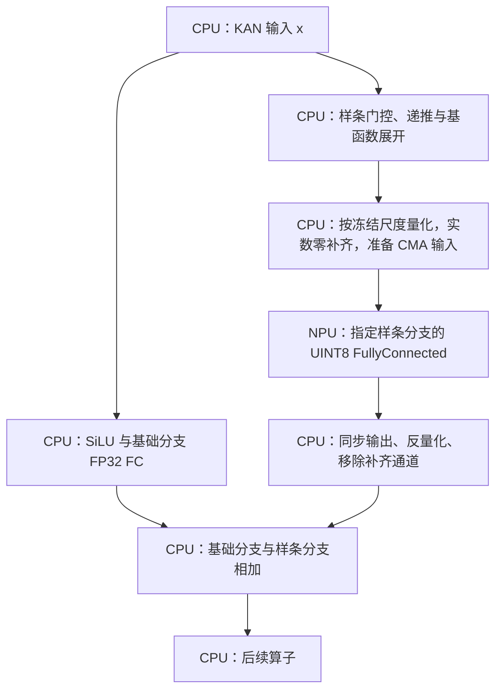

# FF6 模型 CPU/NPU 分配与依据

本文规定冻结 FKP-DVGT 寿命模型在 F3P 上的 `ff6` 执行分配、CPU/NPU 计算边界、选择理由及验证范围。

## 1. 方案与适用范围

| 项目 | 规定 |
|---|---|
| 模型 | `motor_stable23_v1`，使用冻结训练检查点和权重 |
| 输入 | 已归一化 Float32，形状 `[1,23,110]`，每窗 2530 个元素 |
| 输出 | 一个浮点寿命预测值，单位为剩余观测老化试验轮次 |
| CPU | PS ARM 上的融合 C++ / NEON 实现，承担基函数、未卸载的 FC 及其余算子 |
| NPU | 配套 ArmNN 的 `Alnpu` 后端，承担六个 UINT8 样条 FC 分支 |
| 分配计划 | `qparams_ff6.tsv` 的六个权重名；不启用输入投影 Conv 计划 |
| 独立程序状态 | 已完成真实权重、184 窗验证集和三轮交错回放 |
| 应用状态 | `host` 引擎支持六分支严格校验；运行包、暂存与上位机标识均使用 FF6，应用共享库已完成板端 CPU / FF6 各两轮 184 窗，HDMI 本地回放可用 |

六个分支共用同一个硬 NPU。分支数描述模型中被卸载的计算位置，不代表六个 NPU 核、六个注意力头或六个完整 KAN 层。当前分配通过指定权重名完成，不自动将其余可识别算子交给 NPU；六个量化计算图只请求 `Alnpu`，不允许用 CPU 回退结果代替 NPU 验证。

运行环境、冻结权重和数据来源见[额外分支验证](additional-offload-validation.md)与[模型和数据](model-and-data.md)。本方案仅用于板端预测，不涉及训练或重新拟合归一化参数。

## 2. 一个 KAN 层内的计算边界

KAN 层包含基础分支与样条分支，可概括为：

```text
基础分支：y_base   = SiLU(x) × W_base^T
样条分支：y_spline = B(x)    × W_spline^T
层输出：  y        = y_base + y_spline
```

`B(x)` 是按冻结网格计算并展开的样条基函数。FF6 只卸载指定六处 `B(x) × W_spline^T` 的量化计算；基础分支、样条递推以及两分支结果相加均在 CPU。



图中箭头表示数据依赖。当前实现按执行计划同步调用 NPU 并等待结果，没有实现 CPU/NPU 并行重叠。量化、补齐、输入输出同步和反量化均属于迁移边界成本；只比较 NPU 核内计算时间无法判断整模型收益。

## 3. NPU 分配清单

下表中的 `B` 为一次 FC 调用的矩阵行数，不是数据集窗口批量。`I` 已包含样条基函数展开，`O` 为逻辑输出维数；物理 `I/O` 均补到 8 的倍数。

| 权重分支 | 模型位置 | 逻辑 `B × I → O` | 物理 `I → O` | 分配理由 |
|---|---|---|---|---|
| `tvgtformer_blocks.0.feed_forward_temp.0.spline_weight` | 第 0 个时间块，前馈首层样条分支 | `11 × 108 → 140` | `112 → 144` | 真实权重单层测试有边界时间收益，四分支组合已完成精度和整模型回放 |
| `tvgtformer_blocks.1.feed_forward_temp.0.spline_weight` | 第 1 个时间块，前馈首层样条分支 | `11 × 108 → 140` | `112 → 144` | 同类前馈首层，与其他三处分支使用相同验证方式 |
| `svgtformer_blocks.0.feed_forward_spat.0.spline_weight` | 第 0 个空间块，前馈首层样条分支 | `12 × 99 → 140` | `104 → 144` | 真实权重单层测试有边界时间收益，四分支组合已完成精度和整模型回放 |
| `svgtformer_blocks.1.feed_forward_spat.0.spline_weight` | 第 1 个空间块，前馈首层样条分支 | `12 × 99 → 140` | `104 → 144` | 同类前馈首层，与其他三处分支使用相同验证方式 |
| `output_layer.0.spline_weight` | 回归头首层样条分支 | `1 × 1188 → 64` | `1192 → 64` | 保留已验证的回归头量化路径，与四个前馈分支组成选定 FF6；不单独宣称有端到端加速收益 |
| `output_layer.2.spline_weight` | 回归头末层样条分支 | `1 × 576 → 1` | `576 → 8` | 同属已验证回归头路径；逻辑计算量很小，保留依据为选定组合及数值验证，不是独立速度优势 |

例如时间块输入的 12 个特征展开为 108 个样条特征，空间块的 11 个特征展开为 99 个样条特征。因此 `108 → 140` 不能理解为整个 KAN 层的原始输入输出定义。

四个前馈样条 FC 合计 665280 个逻辑 MAC/窗，两个回归头合计 76608 个，FF6 共 741888 个，约占全模型 3501280 个逻辑 FC MAC 的 21.19%。该比例不包含样条基函数、激活、注意力矩阵乘法等计算，也不等于 NPU 时间占比或整模型加速比例。

### 3.1 量化与硬件映射

| 项目 | 执行规定与依据 |
|---|---|
| 类型 | 输入、权重、输出均为 `QAsymmU8`，zero-point 为 128；保留当前硬件与库已通过的类型组合 |
| 尺度 | 从训练集 543 窗校准，按分支使用冻结的输入、权重、输出尺度；六行参数逐行读取，不共用一个任意尺度 |
| 补齐 | 输入、输出维数补到 8 的倍数；新增输入和权重表示实数零，对应量化值 128；结果恢复时丢弃新增输出通道 |
| 偏置 | 量化 FC 使用零 `Signed32` 偏置，尺度为输入尺度与权重尺度的乘积 |
| 图映射 | 原生 FullyConnected 经厂商优化映射为 `Alnpu / ALHardNPU`；FF6 不使用 Conv 表达 |
| 缓冲区 | 持久 CMA 输入输出复用；实际输入量化、同步及输出恢复仍由 CPU 调用完成 |
| 证据 | 同时核对分配图、执行事件、硬核 IRQ 和整数输出；仅后端注册或优化成功不足以证明正确执行 |

原生未补齐 FC 在测试尺寸 `B=11、I=12、O=21` 下通过加载后发生硬件中断超时。补齐方案的 24 种模型尺寸均通过独立对照，因此实际迁移采用已验证的补齐路径；该现象不等于所有未对齐尺寸均不可用。详见[补齐验证](npu-fc-padding-validation.md)。

## 4. CPU 分配清单与保留理由

“保留 CPU”描述当前执行方案。下表分别注明当前表达不支持、已有迁移收益不合适和整体尚未验证，不能将三者统一解释为硬件绝对无法执行。

| 部分 | FF6 中的执行位置 | 分配理由与证据范围 |
|---|---|---|
| 样条门控、三阶递推和基函数展开 | CPU 融合内核 | 保持原网格、区间边界和递推定义；30 组基函数在相应分支间复用。整体尚无通过的 NPU 实现，是当前主要 CPU 热点 |
| SiLU | CPU，与样条计算共同生成 | 保留原数学定义并复用输入。SiLU 整体未完成 NPU 验证；Float32 Sigmoid 查询被拒绝，不能由此推定全部 SiLU 实现都不可用 |
| 全部 `base_weight` 基础分支 FC | CPU / NEON | FF6 的六行计划均是 `spline_weight`；基础分支保持 FP32。输入投影基础分支虽有卷积表达收益，但存在量化裁剪；其他基础分支未逐一完成真实权重组合验收 |
| 输入投影 `linear_x` 的样条分支 | CPU / NEON | FC 表达迁移更慢；等价 Conv 可以加速，但已验证的输入 + FF 组合预测偏差明显大于 FF6，未纳入选定方案 |
| Q/K/V 与注意力输出投影中的样条 FC | CPU / NEON | 不在六分支计划中；模型尺寸支持测试不能替代各分支真实权重下的精度、边界开销和整模型收益验证，不能统称为不支持 |
| 四个 `feed_forward_*.2.spline_weight` | CPU / NEON | 真实权重单层测试可以在 NPU 执行，但含转换与同步的边界时间高于 CPU，详见下一节 |
| `linear_sample.*` 及其余未列入计划的 FC | CPU / NEON | 保持已验证融合路径；尚未完成额外组合下的收益和精度验收 |
| 动态 BatchMatMul | CPU | 当前测试的 Float32 类型和形状被 Alnpu 优化阶段拒绝；涉及两个运行时张量，不可直接等同于固定权重 FC |
| Softmax | CPU | 当前 Float32 支持查询被拒绝；保持现有数值定义，未验证量化或近似表达 |
| PCC、LayerNorm、归约及相关开方/除法 | CPU 融合内核 | 已融合均值、中心化、平方和等操作并保留原 epsilon；整体尚无通过的 NPU 实现，不能由单个基础算子查询替代整体判断 |
| 五处精确 GELU | CPU，`std::erf` | 保持已训练模型的精确 GELU；无通过的 NPU 整体实现，未引入近似 GELU 或查表替换 |
| 分支相加、残差及其他逐元素算术 | CPU | 当前查询的 Float32 Add/Sub/Mul/Div 被拒绝；量化融合表达未完成验证 |
| 其他激活与取整 | CPU | Float32 ReLU、Sigmoid、Tanh、Ceil 的当前测试表达被拒绝，结论限定为配套库、类型与形状 |
| Reshape、转置、切片、拼接 | CPU / 视图或数据复制 | 连续 Reshape 复用视图，必要重排保持现有实现；额外搬运和同步需要端到端收益验证，尚无采用的 NPU 路径 |
| 输入准备、量化/反量化、结果输出 | CPU | 属于推理调度和 CPU/NPU 数据边界；上位机、文件和网络处理均由 PS 应用承担 |

Float32 支持结论来自[支持查询源码](../probe/npu_op_support.cpp)：十项仅调用优化接口，全部返回 40，未加载或执行网络。这只证明被测表达在当前 Alnpu 后端不能分配，不证明 NPU 的所有类型、量化形式或后续运行库都不支持。ONNX 解析器不支持某算子的记录同样不能单独作为硬件不支持的证据。

## 5. 候选分支的取舍

以下时间为真实权重独立层对照。NPU 时间包含量化、补齐、布局处理、同步、执行和反量化；与整模型中的同一分支时间可能不同。

| 候选 | CPU ms | NPU 边界 ms | 当前取舍 |
|---|---:|---:|---|
| 输入投影样条 FC | 2.650 | 3.407 | 能运行，边界成本超过计算收益，保留 CPU |
| 输入投影样条，等价补齐 1×1 Conv | 2.651 | 1.028 | 单层有收益；组合的输出偏差较大，未选入 FF6 |
| 输入投影基础 FC | 0.413 | 1.615 | 能运行但更慢，保留 CPU |
| 输入投影基础，等价补齐 1×1 Conv | 0.413 | 0.231 | 单层有收益，但捕获输入中有 10 个值发生量化裁剪，隔离误差较大，未进行整模型组合验收 |
| 四个前馈首层样条 FC | 0.839–0.898 | 0.403–0.421 | 单层有收益，纳入 FF6 并核对完整模型 |
| 四个前馈第二层样条 FC | 0.775–0.846 | 0.895–0.988 | 能运行但更慢，保留 CPU |

分配顺序为：确认表达可用、核对真实权重整数结果、比较包含边界成本的耗时、核对整模型预测差，最后决定是否纳入计划。算子数量、理论 MAC 和单层核内时间均不能独立决定分配。

## 6. FF6 的整模型依据与性能边界

同一板卡与程序进行五窗预热，使用相同 184 窗验证序列，五种配置交错执行三轮。初始化和结果写盘不计入前向时间。

| 配置 | NPU 分支数 | 三轮均值 ms/窗 | 各轮均值范围 ms/窗 | 验证 RMSE | 相对 FP32 最大预测差 |
|---|---:|---:|---:|---:|---:|
| 融合 FP32 CPU | 0 | 44.520 | 44.076–45.405 | 2.465940 | 0.00000811 |
| 原回归头 | 2 | 44.534 | 44.046–45.500 | 2.467977 | 0.030550 |
| 四个前馈首层 | 4 | 43.917 | 43.010–44.424 | 2.465455 | 0.039159 |
| FF6：前馈首层 + 原回归头 | 6 | 43.358 | 42.830–44.393 | 2.467897 | 0.048573 |
| 输入投影 Conv + 四个前馈首层 | 5 | 41.849 | 41.340–42.734 | 2.447859 | 0.575464 |

FF6 是选定部署方案，采用四个已验证有单层收益的前馈分支，并保留两个已验证回归头。与更快的五分支候选相比，FF6 的验证集最大输出偏差更小。五分支候选的 RMSE 略低，不能据此认定其对独立测试或实际任务更准确；应用允许的预测偏差仍为 TBD。

FF6 的均值较 CPU 低约 2.6%，但两者三轮范围重叠，当前记录不足以证明稳定的微小加速。两个回归头本身也没有稳定的额外端到端收益。分配方案保留这些事实，不将六分支数量作为性能结论。

完整融合 CPU 热点中，样条基函数与 SiLU 约占 47.96%，全部 124 个 FC 约占 41.63%。FF6 只迁移其中六个 FC，其余基函数与计算仍由 CPU 执行。完整上下文中，四个前馈 NPU 分支的边界时间约为 0.56–0.61 ms，也高于独立层反复执行时的测值。

量化转换、通道补齐、同步和串行等待均会抵消核内收益。现有轨迹没有独立测出 DDR 带宽、缓存、同步或频率变化的因果贡献，因此不能断言内存带宽饱和或将全部开销归因于内存速度。

## 7. 验证范围与部署入口

| 验证项 | 已有证据与限制 |
|---|---|
| 真实权重 | 冻结训练检查点、权重及训练集校准尺度，没有重新训练 |
| 数值回放 | FF6 完成 1/10 窗整数对照与三轮完整 184 窗回放；应用精度阈值尚未冻结 |
| 整数审计 | 新组合与独立层合计核对 266344 个物理输出，最大差 1 LSB；该总数不是 FF6 单独的输出数 |
| NPU 执行 | 分配图、执行事件和硬核 IRQ 共同核对；软核 IRQ 未增长 |
| CMA | FF6 完整回放期间恒定为 233472 字节；不等于进程总内存，也不替代长期运行和反复加载/卸载验收 |
| 计时 | 完整速度对照关闭逐输出整数审计；诊断热点计时与正式整模型对照分别使用 |
| 独立测试集 | FF6 尚未完成 165 窗独立测试验收 |
| 应用集成 | 六分支共享库生命周期、Qt / UDP 链路以及 HDMI / 采集 / NPU 共存验收待完成 |

独立模型使用[额外分支包](../artifacts/f3p-offload-rul-arm64-v1.tar.gz)，从[原生模型包](../artifacts/f3p-native-rul-arm64-v1.tar.gz)提供 `weights.bin` 和 `weights.tsv` 后校验。解压根目录为 `f3p-offload-v1`；在已解压并提供权重的目录内，FF6 的明确入口为：

```sh
sha256sum -c checksums.sha256
sha256sum -c weights.sha256
sh run.sh hybrid 1 qparams_ff6.tsv
```

该入口本身不读取 U 盘。首次经 U 盘部署的挂载、解压及逐级执行按[测试规程](testing.md)完成；后续扩大测试范围按[额外分支验证](additional-offload-validation.md)执行。

未指定参数时的默认两分支计划不代表 FF6。该独立包也不包含上位机要求的 `libmlk_rul.so` 与 `model.json`；应用封装所需修改见[六分支应用运行包说明](../../host/ps-local/inference/README.md)。

## 8. 来源与维护依据

| 来源 | 用途 |
|---|---|
| [计划生成工具](../tools/prepare_offload_probe.py) | 六个分支名、计划构成及独立程序生成 |
| [额外分支验证](additional-offload-validation.md) | 支持查询、单层速度、组合精度与三轮耗时 |
| [CPU 热点摘要](../results/board/offload-replay-v1-profile.json) | CPU 分类时间、124 个 FC 的维数及逻辑 MAC |
| [完整结果复核](../results/board/offload-replay-v1-verification.json) | 回放输出、实际 NPU 执行、整数审计和 CMA |
| [CPU 融合定义](operator-fusion-validation.md) | 样条、PCC、LayerNorm、视图及持久工作区 |
| [量化定义](rul-quantization-validation.md) | 校准数据、尺度、舍入和整数参考 |
| [上位机接入说明](../../host/ps-local/inference/README.md) | 应用包、C ABI、清单与六分支适配边界 |

新增 NPU 分配须同步修改明确的计划与本分配表，并提供真实权重的数值、实际后端执行、边界耗时和整模型组合证据。尚未完成验证的候选继续保留 CPU，不能标记为已支持或已加速。
