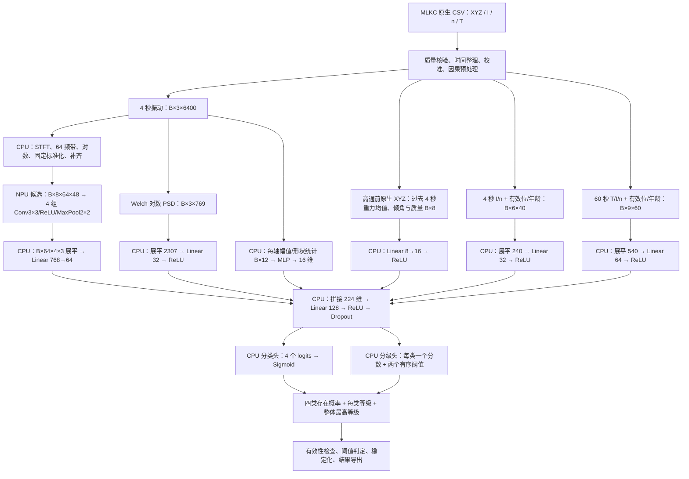

# 电机四类模拟故障识别与三级分级模型设计

本文规定磁粉制动器电机试验平台的故障定义、采集与标注流程、多任务神经网络结构、电脑端 PyTorch 训练方法和独立测试规程。

当前应用采用单主故障输出，任务 `bench_fault_single_v1`、结构 `fault_mtl_f3p_cnn2d_single_v3`：正常加四故障共五类，以最高分类 logit 确定唯一类别，只输出该类别对应的 1～3 级，正常为 0 级。分类训练使用五类交叉熵，分级只监督真实主故障；模型参数量 257137。单故障标签、推断协议与当前权重以[单故障训练与推断](model/单故障训练与推断.md)为准，以下多标签 v2 网络作为对照结构保留。单故障配置不同时报告复合故障组合，不能与多标签权重或标签契约混用。当前单故障模型采用四秒原生块预处理；F3P 移植以[部署与量化规划](F3P部署与量化设计.md)为准，Qt 实时输入、告警适配与操作以[实时接入方案](F3P实时故障诊断接入方案.md)为准，均为待实施方案。

## 1. 方案与目标

推荐采用一个端到端联合训练的**多速率、多分支卷积网络**，结构标识为 `fault_mtl_f3p_cnn2d_v2`：振动时频图使用适合 DR1 NPU 算子集合的二维卷积主干，频谱、运行状态、幅值统计与保留重力的安装姿态使用小型 MLP，再共享融合层，同时输出四个故障存在概率与每类三级有序严重度。一次前向完成分类和分级，多个分支属于同一个模型。

输入配置固定为 **`base6`：机身振动 X/Y/Z、电流 I、转速 n、外壳温度 T**。训练、验证和未来板端推理均只使用这六路现有物理量；欠压依据六路信号的联合响应间接识别。

任务定义为 `bench_fault_sim_v2`：识别真实采样中按项目工艺定义的四类模拟故障状态及三级植入强度。第四类为安装倾斜异常 `mount_tilt`，以相对规定水平安装面的倾角分级；3/6/10° 是待验证的候选分界（REF），规则标识为 `mount_tilt_3_6_10_ref_v1`。模拟外壳过热采用 **35/40/45 ℃** 分界：35～不足 40 ℃为轻度、40～不足 45 ℃为中度、45 ℃及以上且未越过试验上限为重度。温度规则标识为 `case_temp_35_40_45_v1`，不表示实际热损坏温区。各类的轻/中/重均按项目标签解释，实际设备允许倾角、温度、负载和持续时间独立遵守。

电脑端使用 PyTorch 构建和训练。未来板端优先采用“连续 CNN 主干交给 NPU，预处理、小型 MLP 与结果判定留在 PS CPU”的混合执行方式。[model/](model/README.md) 已实现本文 v2 的六分支网络、姿态预处理、标签与版本校验、训练评估和 FP32 导出，并完成合成输入及 GPU 软件检查。姿态实际质量门限、数值水平基准与静态校准仍需按实采核定；尚未完成最终训练或本网络的板端验证。算子证据、量化和移植规程见[F3P 部署与量化设计](F3P部署与量化设计.md)。

| 项目 | 设计定义 |
|---|---|
| 被测对象 | 独立供电与调速的电机，磁粉制动器提供可调机械负载 |
| 四类故障 | 过载 `overload`、电压不足 `undervoltage`、外壳温度过高 `overtemperature`、安装倾斜异常 `mount_tilt` |
| 正常状态 | 四类模拟故障均未触发且试验工况通过审核；必须采集真实正常运行数据 |
| 分级 | 每类故障各有 1 / 2 / 3 级，分别为试验定义的轻 / 中 / 重；健康为 0，未知为 `null` |
| 单故障识别目标 | 健康及四类故障的集合完全匹配准确率 ≥90% |
| 复合故障识别目标 | 在实际采集、约定覆盖范围内的复合故障测试集上，故障集合完全匹配准确率 ≥90% |
| 分级目标 | 对真实存在的故障，类别检出且等级正确的端到端准确率 ≥85%；另报纯分级准确率 |
| 实现环境 | 电脑端 Python / PyTorch；训练和本阶段评估均在电脑执行 |
| 运行阶段覆盖 | 有效历史建立后的正常暖机及合格预运行参考段；热平衡对照可选，启动早期历史不足和故障发生过渡另作专项训练/验收 |
| 当前交付 | v2 设计与采集规格、六分支 PyTorch 实现、标签适配、训练/评估/FP32 导出与软件验证；最终训练和板端验收待完成 |

以上准确率是验收目标，目前只有首批单次自然升温数据及软件流程检查，没有独立精度验收结果，不能由网络结构直接保证。若只采集单故障，只能验收五种互斥状态的识别，不能据此宣称支持同时发生的多故障。本文采用多标签输出以保留复合故障能力，单故障数据可直接用于同一网络。

建议首先明确两个项目边界：

1. “电压不足”定义为**调速器直流输入母线电压低于规定正常范围**；正常降低 PWM 占空比属于调速操作。若实际目标为电机端有效电压不足，必须另行记录调速指令与 PWM 端电压测量方法。
2. “安装倾斜异常”定义为**电机安装基面相对规定水平基准的姿态偏离**，不要求产生真实机械损伤。允许倾斜安装的电机不能仅因倾斜就认定工业故障；本类仅表示平台规定的演示异常。固定螺栓保持正常紧固，电机与磁粉制动器优先在同一刚性支承面整体倾斜并保持轴线关系，不将联轴器不对中或支承松动混入倾斜标签。

## 2. 仓库采集能力与必须补齐的信息

### 2.1 当前可用字段

数据契约见[采集记录、回放与训练接口](../../docs/采集记录-回放与训练接口.md)，硬件来源见[PL-PS 接口](../../docs/PL-PS接口约定.md)与[FPGA 说明](../../fpga/README.md)。实际进入记录的样本还受 [datasource.cpp](../../host/ps-local/src/datasource.cpp) 和 [klocalwindow.cpp](../../host/ps-local/src/klocalwindow.cpp) 的发布路径限制。

| 量 | 硬件 / 配置 | 当前记录路径与限制 | 本模型用途 |
|---|---|---|---|
| 机身三轴加速度 | ADXL345，配置 ODR 3200 Hz | DMA 块发布；应用估算块速率，源码说明实板约 3.1 kHz；必须按实际 `rate_hz` 与质量记录处理。寄存器回退路径只能获得轮询最新值 | 保留重力分量估计安装倾斜；动态分量用于冲击、谐波与振动强度 |
| 电流 | 霍尔模块 → ADS1115，配置 860 SPS | 应用约每 20 ms 读取最新寄存器值，`rateHz=50`、每帧一点；这不是全部 860 SPS 样本 | 低频电流水平及负载响应，不用于高频电流故障谱 |
| 转速 | RS485 编码器，100 ms 采样周期 | 记录为 signed16 ×0.1 rpm，约 ±3276.7 rpm 饱和；底层较高精度不能从记录恢复 | 工作点、速度跌落与波动 |
| 外壳温度 | GT-M601 串口温度采集板 | 更新时发布单点，帧名义速率为 1 Hz；真实上报周期与准确度待实测 | 绝对外壳温度及慢变化趋势 |
| 振动合成量 | XYZ 派生 | `sqrt(x²+y²+z²)`；含重力与安装方向影响，不是第七个独立传感器 | 检查与辅助统计，默认不重复输入网络 |
| 电压 | 当前无可读电压，MLKC 无此通道 | 不建立实时电压采集链路；供电试验记录仅用于审核标签 | 不作为网络输入；欠压采用间接识别 |
| 制动力矩 / 参考倾角 / 环境温度 | 当前 MLKC 无此通道 | 由参考仪表及试验记录补充 | 真实标签与试验条件，不作为网络输入；模型倾角仅从 XYZ 派生 |

电流标定未完成时，当前应用可能输出 0 mA；“数值为零且有效位为 1”不能证明真实零电流。仓库还注明霍尔幅值链路与温度绝对准确度待验证。正式采集前必须用参考仪表完成零点、增益、方向及量程核对，采集中不得执行归零操作；归零会额外发布一个人为 0 mA 样本。

传感器配置速率、PL 成功采样速率、应用发布速率、CSV 网格速率是不同概念。`--native-csv` 保留的是**已经保存的原生样本**，不能恢复未读取的电流转换结果或被 DMA 覆写的振动样本。电流轮询没有在抽取前做相应低通，后续软件滤波不能消除已经产生的混叠；本设计只把它作为慢状态信号，仍需检查 PWM 等干扰是否污染均值。

### 2.2 固定输入配置 `base6`

| 项目 | 固定规格 |
|---|---|
| 输入 profile | `base6` |
| 独立物理量顺序 | `[vibration_x_g, vibration_y_g, vibration_z_g, current_a, speed_rpm, temperature_c]` |
| 硬件范围 | 现有三轴振动、电流、转速、外壳温度采集；无需增加在线电压传感器 |
| 输入来源 | MLKC 导出的原生 CSV；各物理量按各自速率构建分支 |
| 标签来源 | 人工审核的故障植入、供电档位、制动器、温度与独立参考倾角记录 |
| 模型身份 | `architecture=fault_mtl_f3p_cnn2d_v2`、`input_profile=base6`、`task_definition=bench_fault_sim_v2` |

六路指独立物理量，三轴加速度计贡献 X/Y/Z 三路。振动模长、频谱、统计量、重力向量、估计倾角、有效位和样本年龄是从现有采样派生的信息，不代表新增传感器。参考倾角仪或量角装置仅用于校准和标签核验，不要求增加在线倾角传感器。

模型不预留电压值、有效位或样本年龄通道。数据加载、标准化、量化校准和推理均按 `base6` 实现；不得把未知电压填零，也不将供电设定值、故障档位或参考测量偷偷加入网络输入。

欠压与过载、正常调速可能产生相近的 I/n/T/振动响应。首轮数据必须检验其可分性，后续重点报告欠压的分类、三级分级和跨工况表现；若观测分布重叠，仅扩大网络不能保证达到 90%/85%。具体供电植入方式和三级档位仍为 TBD，按 §6.3 区分已核验物理标签、试验代理标签与未知标签。

### 2.3 采集前冻结项

| 项目 | 必须记录的内容 |
|---|---|
| 电机与调速器 | 型号、铭牌电压/电流/功率、允许转速、冷却方式、占空比或转速设定、控制方式 |
| 供电植入工艺 | 正常与三档降压的操作方式、档位标识、适用负载范围、核验依据和重复性；仅作标签元数据 |
| 制动器 | 型号、允许转速、力矩范围、连续/短时耗散功率、冷却方式、励磁—力矩标定 |
| 正常预运行工艺 | 约 15 分钟的参考时点（REF）、实际取段范围、初始热条件、壳温/电机电流/转速统计及工作点漂移限值；时间本身不确认健康 |
| 倾斜工艺与紧固 | 规定水平安装基面、支架和允许倾角、倾斜方向、正常紧固要求、机械限位、轴线关系、参考量角装置与测量误差 |
| 姿态基准 | ADXL345 与机身的刚性连接、静态零偏/增益校准、经水平核验的参考重力向量及 `gravity_reference_id`；不按每次启动重新归零 |
| 温度 | 探头型号与测温原理、壳体测点、接触或非接触测量的安装方式、响应时间、参考温度计、35/40/45 ℃演示分界及实际试验上限 |
| 振动 | XYZ 方向、刚性安装位置、量程、采样率、安装照片和线缆固定方式 |
| 数据质量 | 实际速率、DMA 丢块、UDP 丢包、校准版本、时间偏差、饱和与缺失比例 |

以上尚未给出的具体额定值为 `TBD`。不得把其他电机、轴承数据集或制动器产品的额定值移用到本试验平台。

## 3. 模型设计依据

### 3.1 四类故障的可观测关系

| 故障 | 可用于判断的物理关系 | 设计影响与混淆因素 |
|---|---|---|
| 过载 | 机械负载增加通常改变电流与速度平衡；响应受调速器控制策略影响 | 联合使用 I、n、温升历史与机身振动；低转速本身不能等价为过载，正常高负载必须作为对照 |
| 欠压 | 供电不足可能改变电流、转速及其动态响应，并间接影响温升和振动 | 无 U 输入，依靠多物理量与历史间接识别；不假定欠压必然导致电流增加，需与过载和正常调速作匹配对照 |
| 外壳过热 | 壳温是热传导后的表面状态，具有热惯性；不等同于绕组温度 | 保留绝对温度并使用 60 秒历史；不能用轴承/绕组阈值定义壳温等级 |
| 安装倾斜异常 | 固定在机身并随之倾斜的 ADXL345，其重力在 XYZ 上的投影发生变化 | 从高通前原生 XYZ 保留因果均值与相对基准倾角；动态振动和持续外加加速度会干扰估计，仅靠振动幅值或频谱不保证倾角分级 |

直流电机关系可用 `U_motor ≈ R·I_armature + L·dI_armature/dt + k_e·ω`、`T_motor ≈ k_t·I_armature` 理解，但本平台记录的电流测点可能位于调速器供电侧，不能直接当作电枢电流代入计算。调速器、温度和安装条件都会影响实际关系，依据见 [maxon 电机数据与仿真说明](https://support.maxongroup.com/hc/en-us/articles/360013761160-Motor-data-and-simulation)。

ADXL345 同时测量静态重力和动态加速度，倾角可以由重力向量在各轴上的投影估计，依据见 [Analog Devices：ADXL345](https://www.analog.com/en/products/adxl345.html) 和 [AN-1057：加速度计倾角测量](https://www.analog.com/en/resources/app-notes/an-1057.html)。持续外加加速度、零偏、轴间增益差和安装变化会引入误差；运行中的滤波时延与倾角精度需要本机实测。这些资料不提供本平台的准确率或三级界限。振动采集位置是机身，设计不使用轴承内圈/外圈缺陷频率作为标签依据，也不以 CWRU 等轴承数据替代本平台实采测试。

壳体与绕组之间存在热阻，表面温度与内部温度必须区分，依据见 [Nidec 热阻说明](https://www.nidec.com/en/products/small-precision-motors/technology/motor/glossary/item/thermal_resistance/)。本任务的过热输出表示“已满足项目定义的外壳温度演示条件”，不据此宣称实现绕组温度估计、实际热损坏诊断或热失效预测。

### 3.2 网络形式选择

1. **多速率分支**：振动为 kHz 级，电流和转速为低速状态量，壳温为慢变量。各自编码后融合，避免把 1 秒一个温度重复几千次当作高频信息。
2. **标准二维卷积主干**：短时傅里叶变换将机械振动表示为具有明确时间轴/频率轴的图；使用 3×3 Conv、ReLU、2×2/stride 2 MaxPool。训练中的 BatchNorm 在导出时折叠到卷积。算子范围依据本地 DR1 产品手册，并以实际 SDK 和张量形状探针确认；不把支持 Conv2d 推定为支持任意 Conv1d 或膨胀卷积。
3. **短时时频与长窗频谱互补**：时频图观察冲击能量随时间变化，4 秒 Welch PSD 保留较细的谐波分辨率，幅值统计旁路保留严重度信息；三者来自同一振动窗口。时频图丢失相位和部分细粒度波形信息，应与原始波形 1D CNN/TCN 做精度对照；时序卷积依据见 [Bai 等，TCN](https://arxiv.org/abs/1803.01271)。
4. **四个 Sigmoid 分类输出**：允许过载和过热等同时成立；五分类 Softmax 仅适合互斥单故障，作为基线比较。
5. **有序分级**：1、2、3 有顺序，每类独立学习两个等级边界。借鉴 [Cao 等，CORAL](https://arxiv.org/abs/1901.07884) 的累计二分类思想，采用显式有序阈值参数化，不将 1→3 错判与 1→2 错判视为完全相同。
6. **共享编码、独立任务头**：类别与等级使用共同的物理表征；通过分级损失掩码避免要求健康样本产生故障等级。
7. **运行历史使用固定长度 MLP**：I/n 的 4 秒历史和 T/I/n 的 60 秒历史按明确时间位置展平，小型 MLP 利用水平、波动及变化关系。避免将未核验的膨胀卷积、动态归一化与大量残差相加放入 NPU；其时序归纳能力与 TCN 的差别通过消融衡量。
8. **静态姿态与动态振动分流**：高通前原生 XYZ 的重力估计、倾角与质量信息经小型 MLP 融合；动态振动支路继续去除重力。既保留倾斜的直接观测依据，也避免静态 1 g 分量掩盖动态频谱，不依赖新增 NPU 算子。

首版不使用大型 Transformer、图网络或复杂注意力，原因是当前没有足够实采数据证明其收益。结构升级应由独立验证与消融结果支持。

## 4. 输入窗口与预处理

### 4.1 时间定义和张量

每个样本以 `end_us=t` 为推理时刻，采用左闭右开的历史窗口 `[t-W,t)`。初始步长 1 秒。任何均值、滤波、归一化和标签判定不得使用 `t` 以后的数据。

| 张量 | `base6` 形状 | 内容 |
|---|---|---|
| `vibration` | `[B,3,6400]` | 最近 4 秒 XYZ，经验证后重采样至 1600 Hz |
| `time_frequency` | `[B,8,64,48]` | 主干输入；前三通道为 XYZ 对数时频图，其余五通道为实数零；时间轴末端固定补一列 |
| `spectrum` | `[B,3,769]` | 同一振动窗口的 0～600 Hz 对数功率谱 |
| `vibration_stats` | `[B,12]` | 同一窗口每轴的 RMS、峰峰值、峰值因子、峭度，保留绝对幅值旁路 |
| `mount_pose` | `[B,8]` | 高通前最近 4 秒 XYZ 派生的重力均值、相对基准倾角、模长、覆盖率、有效位和样本年龄；定义见下文 |
| `fast_state` | `[B,6,40]` | 最近 4 秒、10 Hz 的 I/n，及各自的有效位、样本年龄 |
| `slow_state` | `[B,9,60]` | 最近 60 秒、1 Hz 的 T/I/n，及各自的有效位、样本年龄 |
| `fault_target` | `[B,4]` | 四类故障的 0/1 多标签 |
| `grade_target` | `[B,4]` | 存在故障时为 1/2/3；不存在为 0；未知配合掩码 |
| `class_mask` / `grade_mask` | `[B,4]` | 对应任务的标签是否可信 |

快状态通道顺序固定为 `[I,n,valid_I,valid_n,age_I,age_n]`，慢状态固定为 `[T,I,n,valid_T,valid_I,valid_n,age_T,age_I,age_n]`。有效位与年龄不作为额外物理量拟合标准化参数。样本年龄为当前网格时刻减去最近真实样本时刻，按该量的过期门限归一化并截断至 `[0,1]`；缺失填 1，有效位填 0。物理值先标准化，缺失再填 0，不能把未知物理量解释为真实零。

`vibration` 是信号处理与归档中间量，推荐网络前向实际接收 `time_frequency/spectrum/vibration_stats/mount_pose/fast_state/slow_state`。主干逻辑输入只有三个传感器通道，补至 8 通道是保守的物理布局候选，不代表新增传感器或已证明是通用硬件要求。

传感器相对机身的 XYZ 方向在试验中固定，并随安装平台一起倾斜，不预先压成模长。保留幅值是分级的必要条件，不能对每个窗口单独除以其 RMS 或标准差。

`mount_pose` 顺序固定为 `[g_x,g_y,g_z,tilt_deg,g_norm,coverage,valid_pose,age_pose]`。前三项为校准后、高通前原生 XYZ 在最近 4 秒有效连续窗口内的逐轴算术均值，单位 g；`g_norm` 为该均值向量模长。参考重力向量 `g_ref` 必须在规定安装基面经独立水平核验后取得。相对倾角按 `tilt_deg=atan2(norm(cross(g_ref,g_mean)),dot(g_ref,g_mean))×180/π` 计算，不假设 Z 轴就是竖直轴。两向量近零时无效；绕重力方向的纯水平转动不能由此测得。

`coverage` 依据真实源块、实际速率和时间覆盖计算，定义与门限在先导试验后冻结（TBD），不把插值或重复样本计入覆盖。`valid_pose` 同时要求参考基准有效、连续性合格、无饱和及滤波/统计稳定；`age_pose` 为最近真实 XYZ 距推理时刻的年龄，按待冻结时效门限归一化至 `[0,1]`。前五项用训练集固定统计标准化，后三项保留质量语义；无效时前五项占位为标准化零、有效位为 0、年龄为 1，不能解释为真实水平。

`g_ref` 与静态零偏/增益校准写入预处理清单及 `gravity_reference_id`，在安装位置改变后重新核验；推理使用的是事先可取得的校准参数，不读取当前试验参考角度。禁止把每次启动或每个窗口的均值归零，也不在已倾斜状态重新学习水平基准。恒定外加加速度和振动造成的均值偏差不能只凭模长接近 1 g 排除，需用独立参考角度验证。

### 4.2 信号处理规格

1. 根据 MLKC 身份、通道、块序号及块内索引整理数据。native CSV 行顺序是块顺序，跨通道须排序；时间戳相同不一定是重复采样，不能只按时间戳去重。可在导出阶段附加源文件与块内索引作为追溯信息。
2. 在同一连续试验内拼接 60 秒文件分段，处理估计区间重叠；跨分段时间矛盾、无法区分的重复与缺口均做质量标记，不强行拼成完整高频波形。
3. 振动使用 DMA 数据。静态标定后先保留高通前原生 XYZ，用于 §4.1 的姿态均值及质量特征；动态支路以连续、因果高通去除重力/极慢漂移，初始截止 0.5 Hz（REF），再用抗混叠低通，初始通带上界 600 Hz，阻带从 800 Hz 前完成（滤波阶数、衰减与实测频响待冻结），重采样至 1600 Hz。两支路使用同一真实时间区间；必须保留连续滤波状态、排除初始化暂态并记录群延迟。姿态支路不得复用已经高通或逐窗去均值的数据。
4. 1600 Hz 只是统一目标网格。若实际有效输入低于目标或来源是寄存器轮询，不得通过插值宣称获得 kHz 振动；该记录不能进入此 profile。ADXL345 的速率、带宽与高 ODR 输出格式应依据[器件数据手册](https://www.analog.com/media/en/technical-documentation/data-sheets/ADXL345.pdf)核对。
5. 对每轴处理后的 6400 点做 Welch PSD：Hann 窗、`nperseg=2048`、`noverlap=1024`、`nfft=2048`、`scaling=density`、去常数趋势。频率间隔 1600/2048=0.78125 Hz；保留索引 0～768，共 769 点。变换为 `log10(PSD+ε)`，`ε=1e-10 g²/Hz` 为初值，预处理版本固定。
6. 电流在最近历史内低通至适配 10 Hz 网格后降采样，转速按有效原生采样对齐。前述电流原始抽取混叠需另外验收；不能宣称此步补回 860 SPS 波形。
7. 慢分支每秒对 I/n 做过去一秒有效样本统计均值，温度使用不晚于网格时刻的最近真实样本；所有量附带有效位与样本年龄。壳温变化小不等于传感器未更新，更新状态必须结合时间/计数。
8. 振动按训练集逐轴全局均值/标准差缩放，PSD 按训练集逐轴逐频点缩放，状态量按训练集逐物理量缩放；保存冻结参数。验证、测试和推理复用这些参数。

振动统计量在高通/低通后的物理量 g 上、全局标准化前计算：每轴 `RMS=sqrt(mean(a²))`、`p2p=max(a)-min(a)`、`crest=max(abs(a))/max(RMS,ε)`、`kurtosis=mean((a-mean(a))⁴)/max(var(a)²,ε)`；峭度采用非超额形式，零方差情形固定为 0。该 12 维向量用训练集统计标准化后直接送入独立小 MLP，避免样本内归一化层削弱严重度相关的绝对振幅。

二维主干另从同一振动窗口生成固定时频图：

1. 每轴采用长度 512 的 Hann 窗、步长 128、`nfft=512`；`center=False`，只取完整窗口。6400 点产生 `floor((6400-512)/128)+1=47` 帧，帧起点为 0～5888，最后一帧恰好结束于 6400 点边界。
2. 以 PSD 方式定标单边功率谱，频率间隔为 3.125 Hz；保留 0～600 Hz 的 193 个频点。用固定、非训练的 64 频带加权平均矩阵汇总，每行权重和为 1，得到 `[3,64,47]`。线性频带边界为 `j×600/64` Hz，明确保存频点边界权重；不能将重采样网格或零填充称为提高了频率分辨率。
3. 取 `log10(PSD+1e-10)`，按训练集逐轴逐频带统计标准化，保留 47 个有效时间位置。再在时间轴右侧补一列标准化实数零至 48，通道末尾补五个实数零至 8。补齐不进入均值/方差拟合，不代表真实观测或未来信号。
4. 图的两个空间轴分别为频带与时间；禁止把原始 6400 点简单 reshape 成二维图片。短窗与频带汇总会降低窄谱峰分辨能力，因此仍保留 0.78125 Hz 的长窗 Welch PSD 分支，并保留幅值统计旁路。

STFT、Welch、对数、校准、掩码和时间对齐在电脑训练预处理中实现，未来板端由 CPU 完成并逐项核对。它们不放入需要通过厂商解析器的 CNN 图；性能评估必须计入这些处理的耗时。

变速时频谱峰会展宽，首版由转速分支辅助解释。可消融转速条件频带或阶次特征；当前约 10 Hz 转速及估算 UTC 不支持声称具有精确转角同步能力。低转速下半阶分辨率不足时增加振动窗长并形成新 profile，不以零填充提高真实频率分辨率。

### 4.3 样本可用性

正式测试同时报告数据可用率；不能通过大量排除难样本制造高准确率。

| 条件 | 初始处理规则（REF，先导采集后冻结） |
|---|---|
| 振动有明确 DMA 丢块、来源回退或饱和 | 受影响窗口不可用；小幅时间重建误差另行量化，不跨已知丢块插值 |
| 转速接近记录饱和值 | 不可用；先限制试验工作范围或升级记录格式，再开展对应转速试验 |
| 电流未校准、ADC/毫安记录饱和 | 不可用；不以 0 值填补 |
| I/n 长期缺失 | 正式全任务输出不可用；短缺失用掩码，覆盖率目标 ≥95%，I/n 单次失联初值上限 0.5 s |
| 温度 | 记录实际更新周期；新鲜度初值上限 6 s，且需通过完整 60 秒历史质量检查 |
| 历史不足 | 连续有效采集不足 60 秒时显示“历史不足”；这是模型输入历史条件，不要求等待十几分钟达到热平衡。提前记录的停机/启动背景是否可用须通过启动专项验证，不能仅凭长度已满直接判定合格 |
| 标签边界与测量误差重叠 | 该等级标签设未知，不强制取最近一级；分类可在可确认时单独监督 |
| 姿态支路 | 无有效水平基准、传感器相对机身移动或 XYZ 质量不合格时，完整四类输出不可用，不以默认角度 0 代表正常。独立参考角度仅用于采集标注和验收；参考证据不足或测量不确定性跨 3/6/10° 候选边界时按 §6.6 屏蔽对应标签，不要求在线读取外部参考倾角 |

短缺失掩码不等于传感器失效泛化能力。若需要长期缺失时部分输出，必须增加按类别的有效状态和专项测试，不能自动报告健康。

当前 0.5 秒连续性门限为严格设计初值。首批数据存在周期缺口与较短的振动时间轴间隙，保守筛查为零不代表温度子任务或所有原始样本无效。逐格慢历史缺失标记可作为独立探索候选，但不能绕过近期振动质量检查；与时间轴直接拼接、波形插值的取舍及采集端排查见[缺口处理方案](缺口处理方案.md)。原始数据与既有严格筛查结果不改写。

## 5. 网络结构与框图

### 5.1 总体框图



图中为固定的 `base6` 配置，CPU/NPU 标注表示未来板端执行分工。电脑端训练时所有可学习层均属于一个 PyTorch 模型、共同反向传播；STFT 与 PSD 是固定信号处理。小型状态分支仍是该模型的一部分，不是另一个模型。板端 CNN 目标为一个连续量化子图，减少逐层 CPU/NPU 往返。

### 5.2 参考层配置

所有尺寸是 v2 候选实现规格，最终超参数仅在训练/验证集合内调整。`B` 为训练批大小；板端冻结 `B=1`，二维张量为 NCHW。所有 Conv2d 均为普通 `groups=1`、dilation=1、k=3×3、stride=1、padding=1；所有 MaxPool 均为 k=2×2、stride=2、padding=0、`ceil_mode=False`。

| 分支 | 层配置 | 输出 |
|---|---|---|
| 时频块 1 | Conv2d 8→16→BatchNorm2d→ReLU→MaxPool | `[B,16,32,24]` |
| 时频块 2 | Conv2d 16→32→BatchNorm2d→ReLU→MaxPool | `[B,32,16,12]` |
| 时频块 3 | Conv2d 32→64→BatchNorm2d→ReLU→MaxPool | `[B,64,8,6]` |
| 时频块 4 | Conv2d 64→64→BatchNorm2d→ReLU→MaxPool | `[B,64,4,3]` |
| 时频汇聚 | CPU 固定顺序展平 768 维，Linear 768→64→ReLU | `[B,64]` |
| 长窗频谱编码 | CPU 展平 2307 维，Linear 2307→32→ReLU | `[B,32]` |
| 振动统计旁路 | 12 个物理统计特征，Linear 12→16→ReLU；不使用样本内归一化 | `[B,16]` |
| 安装姿态编码 | CPU `mount_pose` 8 维，Linear 8→16→ReLU；保留重力与倾角 | `[B,16]` |
| 短时状态编码 | CPU 按通道优先、时间从旧到新展平 240 维，Linear 240→32→ReLU | `[B,32]` |
| 慢时状态编码 | CPU 同序展平 540 维，Linear 540→64→ReLU | `[B,64]` |
| 共享融合 | Concat 224→Linear 128→ReLU→Dropout(0.2) | `[B,128]` |
| 类别头 | Linear 128→4 | `class_logits[B,4]` |
| 等级头 | Linear 128→4 得到每类严重度分数；每类两个有序阈值 | `grade_logits[B,4,2]` |

两任务头实现上可合并成 `Linear 128→8`，前四维为分类 logits，后四维为严重度分数；损失与语义仍独立。融合顺序固定为 `[时频64, 长谱32, 幅值16, 姿态16, 短态32, 慢态64]`，共 224 维。v2 六分支中的姿态支路与其余支路共同训练，参考倾角真值不拼入输入。

现有数据的快速训练配置使用 `temperature_isolation=true`：过载、欠压、倾斜路径屏蔽温度值、有效位和年龄，过热路径只读取温度信息；两路径共用已有编码/融合参数并分别选取对应任务输出。CNN 执行一次，参数量保持 257008，Linear MAC 为 259488/窗。该配置消除对显式温度通道的直接依赖；温升对真实电流和振动的影响仍需通过多温度采样覆盖。具体实现与验证见 [快速训练说明](model/快速训练说明.md)。

卷积训练时 `bias=False`、BatchNorm 使用运行均值/方差；导出时转 `eval()` 并折叠 BN，运行图变为 Conv（含折叠偏置）→ReLU→MaxPool。BN 推理时是固定仿射变换，可以折叠；GroupNorm/LayerNorm 依赖当前输入统计，不能按同样方法折叠。依据见 [PyTorch 卷积与 BN 融合](https://docs.pytorch.org/docs/stable/generated/torch.nn.utils.fuse_conv_bn_eval.html)。首层五个补齐通道的权重固定为零，固定布局的数值等价性单独检查。

网络只在完整历史窗口结束时给出结果，CNN 在该窗口内部使用对称 padding 不会读取 `t` 之后的样本。慢状态 MLP 直接连接全部 60 秒输入；固定时序位置使其能够描述变化，但不能把它宣称为与 TCN 数学等价。

按物理首层 8 通道计算，卷积和 Linear 权重共 256288 个，MAC 为 12581536/窗，约 12.58 M；其中 CNN 为 12386304，其他 Linear 为 195232。BN、偏置与有序阈值计入后总参数为 257008，约 0.257 M，含补齐通道的 720 个固定零权重，属于结构算术估计，不是已运行 v2 模型的 profile。布局补齐、量化转换、缓存同步、FFT 和内存访问另计，不能据 MAC 推断板端时延。该结构保留 Soft NPU / CPU 路径选择余地，但本版融合不依赖 Soft NPU 的六输入 Concat 或 Add。

### 5.3 分类、分级与一致性

类别顺序固定为 `[overload, undervoltage, overtemperature, mount_tilt]`。类别顺序、姿态支路或融合形状不匹配的缓存、权重与运行包拒绝加载；不能仅改显示名称将松动输出解释为倾斜。

分类：`p_c = sigmoid(class_logit_c)`；验证集冻结每类阈值 `τ_c` 后，`present_c = (p_c ≥ τ_c)`。全部为否才输出健康；若质量检查失败则输出不可用，不能输出健康。

等级：每类共享一个分数 `s_c`，设 `θ_c1=a_c`、`θ_c2=a_c+softplus(b_c)+1e-4`，并计算：

```text
q_c1 = sigmoid(s_c - θ_c1) = P(grade > 1 | fault c is present, x)
q_c2 = sigmoid(s_c - θ_c2) = P(grade > 2 | fault c is present, x)
q_c1 ≥ q_c2

P(grade=1 | c,x) = 1 - q_c1
P(grade=2 | c,x) = q_c1 - q_c2
P(grade=3 | c,x) = q_c2

g_c = 1 + 1[q_c1 ≥ 0.5] + 1[q_c2 ≥ 0.5]
reported_grade_c = g_c if present_c else 0
overall_grade = max(reported_grade_c)
```

0.5 累计阈值解码是首版统一规则；若比较三级概率 argmax，应在验证集选择并冻结，不在测试集上切换较优规则。累计阈值给出有序决策，但不保证模型分数与每个物理输入全局单调。

例如过载二级且外壳过热一级，输出存在向量 `[1,0,1,0]`、等级 `[2,0,1,0]`。`overall_grade=2` 只是一项项目内最高等级汇总，不能代替每类结果，也不表示不同故障的实际风险已经等价标定。

## 6. 故障植入和三级标签标准

### 6.1 分级原则

分类真值由真实采样、实际执行的模拟工艺与冻结的演示规则共同确定。等级可以由实测量区间或已审核的工艺档位定义，须明确 `label_basis`；不要求通过真实损坏达到三级。欠压在无在线电压条件下的标注规则见 §6.3，35/40/45 ℃模拟过热见 §6.5，倾斜分级候选规则见 §6.6。倾斜数值角度标签来自独立参考测量；当前批次也支持操作者明确确认的文件名模拟档位，单独保存规则且不宣称与参考角度区间等价。标签不由网络估计角、模型预测、聚类或振动强弱生成，最高演示档位不解释为通用工业风险标准。

对于每类定义“随严重度增大而增大”的量 `s_c`，冻结正常边界 `b_c0`、两个等级分界 `b_c1,b_c2` 和最高试验界 `b_c3`：

| 状态 | 项目定义区间 |
|---|---|
| 无该故障 | `s_c < b_c0`，且满足其他确认条件 |
| 一级 | `b_c0 ≤ s_c < b_c1` |
| 二级 | `b_c1 ≤ s_c < b_c2` |
| 三级 | `b_c2 ≤ s_c ≤ b_c3` |
| 超出试验范围 | `s_c > b_c3`，停止试验并标为越界，不能并入正常三级数据 |

边界附近按参考仪表误差与状态波动设置死区；测量置信区间跨边界时，等级标签未知。初步没有行业适用阈值时，可将**已经确认可控的异常试验区间**按 `b_c1=b_c0+(b_c3-b_c0)/3`、`b_c2=b_c0+2(b_c3-b_c0)/3` 划分，仅作为 REF 的“植入强度等级”。正式采集前冻结，不能按测试集结果调整；不得把三等分解释为工业风险标准。

如果正常边界与最高允许试验界之间不足以形成三个可区分区间，需重新设计演示区间与等级，不能越过设备边界凑齐三级。35/40/45 ℃为已指定的模拟过热分界，3/6/10°为倾斜候选分界（REF）；未冻结的倾斜执行范围、安培、扭矩档位、温度试验上限及实际设备限值均保持 TBD。

### 6.2 各类植入方法

| 类别 | 植入步骤 | 真值与分级量 | 控制和核对 |
|---|---|---|---|
| 过载 | 固定正常供电档位及选定调速设定；从正常演示负载增加制动器励磁，进入已冻结的三级较高负载模拟档位，记录状态保持段后卸载恢复 | 可用经核验力矩区间或 `load_protocol_proxy` 定义；正常演示上界与模拟档位在设备允许范围内冻结，不要求超过额定负载 | 励磁电流不是电机电流，也不等于已知力矩；工艺需覆盖温升与正/反向误差。仅在模拟标签已冻结时把对应高负载称为模拟过载；不据此声称真实超额定过载 |
| 欠压 | 固定制动负载、控制模式和调速设定；通过可重复的供电调节方式设置正常及三档降压条件，人工记录实际执行档位和时间，随后恢复；具体装置待确认 | 当前按已核验供电工艺建立三级植入档位；证据不足时仅为 `supply_protocol_proxy`。若另有独立参考证据，可按 §6.3 建立物理欠压标签 | 供电档位仅用于标签；降低 PWM 占空比属于正常调速对照。控制器保护/重启单独标记；不得从转速、电流变化倒推真值 |
| 外壳过热 | 允许工况下自然升温/冷却，或用吹风机等受控外部热源加热壳体；完整热循环和各温区预热后驻留均可采集 | `s_OT=T_case_measured`，`b_OT0=35 ℃, b_OT1=40 ℃, b_OT2=45 ℃`；`label_basis=temperature_demo_threshold`，使用经校准壳温按连续区间标注并人工核验，独立参考读数可用时对照 | 测点与测温方式固定，不局部只加热测头；控制升温速度，使各级有足够驻留。温度演示分界与实际试验上限分别管理 |
| 安装倾斜异常 | 停机后将电机及磁粉制动器的共同刚性支承面设置为规定方向和倾角，保持正常紧固与轴线关系；参考量角装置核验后启动，恢复水平后复测基线 | `s_tilt=theta_ref_deg`，`label_basis=inclination_reference`；3/6/10°为 REF 候选分界，正式规则与允许上限按 §6.6 冻结 | ADXL345 必须固定在机身并随之倾斜；记录实际角度、方向、参考误差与支承状态，不仅记录垫块高度或计划档位；不得通过松动底脚制造倾斜 |

磁粉制动器的扭矩由励磁和工作状态共同决定，应建立本机标定表。耗散机械功率为 `P=T_brake×2πn/60`，逐档检查本机制动器允许功率与持续时间；最高允许转速不代表该转速可施加最大力矩。依据见 [Magtrol 磁粉测功机的工作原理与选型](https://www.magtrol.com/product/powder-brake-dynamometers-pb-series/)。该厂商示例不代表本平台具体型号。

恒压励磁的线圈温升可能经励磁电流变化影响制动力矩，相关原理见[三菱电机的试验机用磁粉制动器说明](https://www.mitsubishielectric.co.jp/fa/products/drv/tencon/pmerit/case/whats/whats_tencon_ap03.html)。电机电流下降、转速上升仅提示运行点变化，不能据此确认制动器退磁、已知负载减小或电机健康。供电/调速变化、机械及测量因素仍需核验；旋钮不变不能证明力矩不变，工况或过载等级漂移时重新审核标签。

植入规程须把停机条件写入试验单：电机/制动器热限、供电限流或保护动作、异常位移、持续饱和、安装约束失效等；模型不参与安全停机判定。磁粉制动器支座、联轴器对中和制动器自振会影响机身振动，需保存健康负载扫描作对照。

### 6.3 无在线电压时的欠压标注

`base6` 不需要在线电压输入，但监督学习仍需要独立于六路输入的试验标签依据。记录实际执行的供电档位、调速位置、制动器设定、持续时间、供电装置及工艺核验记录；计划档位未经执行审核不能直接成为真值。

| 证据条件 | 标签处理 | 可报告范围 |
|---|---|---|
| 有覆盖当前负载与稳定区间的参考读数，或已核验且带误差界的供电标定记录 | `label_basis=voltage_reference` 或 `supply_calibrated`；依据正常下限和冻结边界确定类别与等级 | 覆盖该装置、负载与误差范围的物理欠压识别/分级 |
| 仅确认可重复的降压工艺、执行档位与顺序，缺少实际母线电压依据 | `label_basis=supply_protocol_proxy`；正常档及三级降压档用于单独的代理训练/评估 | 规定供电植入条件及档位的识别，不能换算成实测欠压百分比 |
| 只有计划、未知旋钮位置、正常 PWM 调速，或无法确认供电操作 | 欠压 `present=null, class_mask=0, grade=null, grade_mask=0` | 不参与欠压监督与对应准确率统计 |

若有独立电压依据，物理量可定义为 `s_UV=max(0,1-U_bus/U_ref)`；这些参考值只参与标签审核，不进入模型。当前没有可读电压时不计算该量，也不虚构电压 CSV。人工参考读数或既有供电标定是可用时的标签证据，不是新增在线传感器的前置要求。

只有欠压存在可信、等级不可信时，保留类别监督并将 `grade_mask=0`。同一训练/测试版本应冻结等级依据；工艺模拟档位与物理区间未经核验映射不能混成同一种三级真值。已审核工艺可用于本项目模拟任务验收，结果明确标示供电档位模拟口径，不据此宣称已完成实际母线欠压百分比的三级验收。

### 6.4 复合故障和温升耦合

过载引起的正常温升不是自动的过热；当参考壳温真正跨过已冻结的过热边界时，才同时添加 `overtemperature`。已经卸载但壳体仍过热的冷却段，应标 `[0,0,1,0]`，不能沿用过载标签。

先采健康和十二种“单故障×等级”状态，再在设备允许组合内采集双故障。可优先研究过载+过热、欠压+过载、倾斜+过载；具体组合按试验边界确定，不能假定四类故障的任意组合都可以安全、稳定地产生。

复合样本逐类记录等级，例如过载二级+倾斜一级。输入波形不能通过将两段单故障数据数值相加来代替真实复合故障；神经网络支持多标签，也不意味着在从未采集的组合上已被验证。

### 6.5 35/40/45 ℃模拟外壳过热规则

| 项目 | 当前规格 |
|---|---|
| 任务标签 | `overtemperature`，显示名称为“模拟外壳过热” |
| 正常温度侧 | `T<35 ℃`，`present=0, grade=0`；全健康仍需其他三类均未触发 |
| 一级：轻度模拟过热 | `35≤T<40 ℃`，`present=1, grade=1` |
| 二级：中度模拟过热 | `40≤T<45 ℃`，`present=1, grade=2` |
| 三级：重度模拟过热 | `45 ℃≤T≤b_OT3`，`present=1, grade=3`；实际试验上限 `b_OT3` 为 TBD，越界记录不得继续按合格三级采样 |
| 测量死区 | 按温度校准不确定度设置，具体宽度为 TBD；未核定的 ±2 ℃暖机波动不作为传感器误差直接代入 |
| 依据标识 | `task_definition=bench_fault_sim_v2`、`temperature_rule=case_temp_35_40_45_v1`、`label_basis=temperature_demo_threshold`，规则、单位及版本写入标签清单 |

边界处按上述半开区间归属，35 ℃属于一级、40 ℃属于二级、45 ℃属于三级；测量不确定性跨越边界时屏蔽不可信的等级，35 ℃附近分类也无法确认时同时屏蔽类别。不同日期、加热/冷却方向及加热器开关状态使用相同区间规则，不能任意改变同一温度的目标。已有记录按该完整规则统一标注，未达到或未取得的温区如实报告支持数缺口。

训练样本不必每次从正常温度起步。可先把壳温调到目标温区，再在电机正常运行工况下记录同级驻留；停机预热后的启动过渡另作标注，不能用停机加热数据替代运行故障主集。初版同状态窗口仍要求过去 60 秒连续处于同一温区且其他标签可信；每级争取 3～5 分钟合格驻留，不能拼接独立短段补足历史。

完整的正常→一级→二级→三级及冷却记录仍需单独采集，用于故障发生/等级切换训练与延迟评估；快速跨界段保留在事件集。若 35～40 ℃或 40～45 ℃被快速加热穿过、停留不足 60 秒，本次不会形成该级的稳态主集窗口，但并不要求每次平台驻留都重采前面的升温过程。

吹风机作为外壳状态模拟热源，不追求最快跨过全部等级。测温需反映固定壳体测点，避免测头直接受热风而壳体尚未达到目标；接触探头保持贴合，非接触探头保持测距、视场及表面条件，实际探头类型按硬件核对。记录热源、距离/档位、开关时间和温度趋势，尽量保持转速、制动负载与传感器安装一致。采集同温区下吹风机开启和关闭后的数据，并保留低于 35 ℃的匹配气流对照，防止将加热器声音/气流/安装扰动作为故障捷径；相关记录按同一 session 分组。

连续记录按测温时刻切分标签，不按开机满 30 分钟自动标故障。自然升温可以用于该模拟类别；若同时出现模拟过载等状态，保留对应多标签。单独过热样本应有经审核的正常负载对照；电流/转速漂移或其他状态未知时保留相应掩码，不强行视作单故障。

模拟分级不替代设备限制。45 ℃是三级的下边界，不能当作允许持续加热的无限区间；实际温度、持续时间和加热方式须在已核验范围内。外部加热不证明内部绕组过热，也不要求制动器加重负载。训练保持绝对壳温输入，并与相同实测温度和死区规则的 35/40/45 ℃直接分级基线比较；该成绩表示演示状态识别能力，不单独证明复杂热机理诊断能力。

### 6.6 安装倾斜异常与三级候选规则

本类使用 `mount_tilt`，显示名称“安装倾斜异常”。`theta_ref_deg` 是规定电机安装基面相对水平面的夹角幅值，由独立参考量角装置测量；方向用 `tilt_direction` 单独记录，同一角度向前、后、左、右倾斜使用同一等级。参考测量只参与标签核验，输入倾角仅按 §4.1 从 XYZ 计算。

| 状态 | 候选参考角度区间（REF） | 标签 |
|---|---|---|
| 正常侧 | `0≤theta_ref_deg<3°` | `present=0, grade=0`；全健康仍需其余三类均未触发 |
| 轻度 | `3°≤theta_ref_deg<6°` | `present=1, grade=1` |
| 中度 | `6°≤theta_ref_deg<10°` | `present=1, grade=2` |
| 重度 | `10°≤theta_ref_deg≤theta_stop_deg` | `present=1, grade=3`；允许上限为 TBD |
| 越界或未核验 | 超过允许上限，或参考角度/支承状态无法确认 | 越界单独记录；不可信类别和等级使用未知掩码 |

候选规则为 `tilt_rule=mount_tilt_3_6_10_ref_v1`，状态为 REF；正式数据采集前根据支架允许角度、参考误差、运行偏差和各级间隔冻结并赋正式规则版本。3/6/10°分别归入 1/2/3 级，不能将候选分界当作设备允许极限。参考角度误差区间跨越 6/10°时等级未知，跨越 3°且存在状态也不可信时类别同时未知；死区宽度为 TBD。正式采集优先选各等级内部并远离误差死区的角度，同时另采边界专项，不在测试集上调整分界。

当前选中批次的模拟训练标签按操作者确认的文件名建立，规则为 `operator_filename_grade_v1`。`mount_tilt_g1/g2/g3` 分别监督倾斜存在及 1/2/3 档，使用 `label_basis[3]=operator_confirmed_filename_grade`，分类和分级掩码均为 1。需保存确认范围、真实源文件名和标签契约 `fault_labels_v2_operator_v1`；不生成 `theta_ref_deg` 或测量误差。该规则表示模拟工艺档位，3/6/10°候选区间仅约束 `inclination_reference` 标签，两种依据不能在同一数据集中混合分级监督。正常暖机经确认正常电压、正常负载、水平放置，可作为四类正常负例。数值重力校准和输入质量要求独立核验。

实施与核验要求：

1. ADXL345 刚性固定在机身并随平台一起倾斜；保持相对机身位置、轴向与线缆约束。传感器留在水平桌面或只转动传感器均不构成本类合格植入。
2. 参考水平用独立水平尺/量角装置核验，静止背景记录 5～10 秒（REF）形成 `g_ref`；先核对三轴零偏与增益。已存在倾斜的启动不能重新归零。安装变化后建立新的校准身份，同一平台的启动不自动生成新基准。
3. 停机后用可锁定的刚性倾斜支架调整共同安装面，保持电机与制动器轴线关系及全部正常紧固；确认机构允许倾角、限位和参考读数后再启动。倾斜方向、角度、支架和参考读数均记录，避免混入松动、不对中、接触位置或传感器移动等变化。
4. 每一等级、方向和工作点先争取 2～3 分钟合格运行驻留；恢复经核验的水平后重新设置，每条件约 3 次独立重复（REF）。按实际使用范围覆盖前后/左右方向；正式矩阵与留出方向测试见 §7，不以单一方向的成绩宣称任意方向可用。
5. 启动、调整、参考角度稳定和恢复分别记录时间；初版只在停机时改变角度，不能用运行中手扶倾斜替代固定姿态数据。需运行中倾斜事件能力时，另行设计受控机构和专项训练/测试，当前保持未验证。

首批自然升温记录经操作者确认全程正常运行、水平放置。其 v2 倾斜标签记为 `present=0,grade=0,class_mask=1,grade_mask=0`，依据为 `operator_confirmed_horizontal`，不填写虚构的数值参考角度、误差或重力校准。该记录没有倾斜正例；温度标签继续按模拟温度规则解释。v2 清单单独生成，原始记录、既有切片及 v1 标签保留。其他 v1 记录若没有独立参考或操作者明确水平确认，第四类使用未知掩码，不能从松动负例直接推断倾斜状态。

### 6.7 版本与实现边界

| 项目 | v2 设计要求 |
|---|---|
| 任务与类别 | `bench_fault_sim_v2`，第四类 `mount_tilt`；与 `bench_fault_sim_v1` 的 `mount_looseness` 语义不兼容 |
| 网络与输入 | `fault_mtl_f3p_cnn2d_v2`、`base6`，六分支、`mount_pose[B,8]`、融合 224 维；CNN 子图尺寸维持 §5 规格 |
| 参考与规则 | 温度规则 `case_temp_35_40_45_v1`；倾斜数值候选 `mount_tilt_3_6_10_ref_v1`；当前模拟档位 `operator_filename_grade_v1`，单独记录依据；保存水平基准、校准和规则状态 |
| 当前实现 | [model/](model/README.md) 已实现 v2 六分支、姿态预处理、224 维融合及标签/缓存/权重/导出版本校验；软件检查不代替真实倾斜精度与板端验证 |
| 快速训练配置 | `base6_native_blocks_short_context_v2`；四秒有效上下文、独立原生块 PSD、训练侧暖机参考、温度隔离头及记录内 60/20/20 三分；开发权重与连续波形配置分开，不作为正式长历史或板端验收 |
| 既有资料 | 首批数据及工具生成的 v1 清单按其声明解释；v2 审核清单单独生成，禁止直接重命名第四类或沿用不匹配的缓存、权重和验证结论 |

## 7. 试验组织与采样数量

现场连续记录、正常暖机、每档驻留时间、独立重复和交接要求见[采集执行规程](采集执行规程.md)。下述时长均指同一审核状态/等级内的驻留，升温、切换和恢复时间另计；不要求所有故障都达到热平衡。

正常参考采用已核验工况下约 15 分钟的预运行时点（REF），不用等待温度平台。当前现场报告为电机壳温约 15 分钟 28±2 ℃、约 30 分钟 40 ℃，并伴随电机电流下降/转速上升。28±2 ℃是候选正常背景；40 ℃按 §6.5 对应中度模拟过热，仍需审核温度边界不确定性与其他状态。取段和漂移审核按[采集执行规程 §3](采集执行规程.md#3-正常数据的采集)执行。未知制动器热边界及负载有效性时，不继续延长加载来等待平衡，也不因运行到第 15 分钟就自动标健康。

### 7.1 先导采集

1. 完成健康状态下的电流、转速、温度与振动标定，验证实际记录速率及饱和边界。
2. 在一个中间工作点采健康+十二个单故障等级，每个条件至少 3 次独立恢复、重新设置和采集，共 39 个先导 episode（REF）；高等级是否可采由物理边界决定。
3. 检查故障间可分性、等级间重复性、温度滞后、倾角估计误差与方向变化、支架重新设置重复性及欠压/过载混淆。
4. 固定 `base6` 输入，冻结等级依据、操作工艺、数据质量规则和正式采集矩阵。先确认电流测量可靠、供电档位可复现，核对欠压与过载/正常调速是否可分；证据不足的欠压等级保持未知或进入单独代理试验。

### 7.2 正式采集参考矩阵

| 维度 | 初始计划（REF） |
|---|---|
| 基础状态 | 健康 1 种 + 4 类×3 级 = 13 种 |
| 工况 | 至少 3 个正常工作点，覆盖允许范围内低/中/高转速设定；在每类内改变允许的背景负载、供电档位或热状态，记录为试验元数据 |
| 独立重复 | 每个状态×工作点至少 10 次独立 episode，约 390 次；不是把一条长记录切成 10 段 |
| 非热态有效段 | 每次争取 120～180 秒，其中最少 60 秒用于完整历史；不得为凑时长超过允许持续时间 |
| 热态记录 | 记录允许范围内的升温、等级保持与冷却；同级段争取 3～5 分钟，受实际允许持续时间约束，不要求达到温度平台 |
| 复合故障 | 对选定双故障组合和等级配对另加实采；跨工况、跨独立重复覆盖，不混入单故障计数 |
| 干扰与正常对照 | 正常加减速、正常负载变化、未过热的暖机、允许的供电档位变化、正常高负载、健康重新装配 |
| 倾斜覆盖 | 按允许使用方向扩展各等级和工作点；每次独立恢复水平、重设角度并核验，跨日期与热背景分布；单方向限制须写入验收范围 |

390 次只是组织起点，不是达到准确率的样本量保证。最终按独立测试 episode 的置信区间和各类误差决定增采；大量重叠窗口不能替代独立试验。

采用分块随机顺序，避免全部三级故障只在当天末尾高温时采集。热试验可按物理可行顺序进行，但应跨天重复冷热循环，并在每个热循环内安排不同类型对照。一个热循环内的所有文件和窗口属于同一拆分组。

每次支架重设或传感器重新安装后核验水平和基准并采健康对照；不同故障覆盖相近转速和载荷，避免“低速就是欠压”“高转速就是倾斜”。健康对照使用相同支架、外部加热装置、风扇和线缆布置；倾斜先导比较同一角度下停机/运行和不同转速的估计偏差，防止振动均值偏差或支承变化主导标签。

若只有一台电机，报告只能说明该平台跨日期/工况/重新装配的泛化。验证同型号跨电机能力需至少多个独立电机，并保留完整未见电机作测试。

### 7.3 `base6` 的欠压可分性对照

| 对照组 | 控制与变化 | 检查目标 |
|---|---|---|
| 正常供电、正常调速 | 改变调速设定，保持正常负载；保留稳态与加减速段 | 避免将低转速或速度下降直接判为欠压 |
| 正常供电、逐档加载 | 固定调速设定，用磁粉制动器改变负载 | 学习过载响应，并检查供电能力不足造成的伴随异常 |
| 固定调速/负载、逐档降压 | 只改变已核验供电工艺档位，跨多个正常工作点重复 | 检查欠压间接特征及三级响应的重复性 |
| 相近转速的健康/过载/欠压 | 在已采样本中按相近实测转速与冷热状态分组比较，保留完整测试分布 | 揭示靠单一转速或温升区分的捷径，重点分析 I/n 联合关系 |
| 过载与欠压复合 | 在允许的植入组合内同时改变负载和供电工艺 | 检查两个标签能否同时检出；避免把复合状态强制归为单一类别 |

各类应覆盖多次独立设置、多个日期和至少三个工作点；划分时保持完整 session 独立，并增加留出工作点的专项测试。供电档位、调速旋钮位置、制动器励磁设置和操作时间仅用于试验审核/分组，不能作为额外预测输入。正常加减速等过渡数据另作动态误报测试，不因不属于稳态训练集而省略。

先用训练/验证组比较 I/n 历史、增加温度历史、再增加振动的增益，并列出欠压与过载/健康的混淆。如果同类等级不重复或不同故障响应重叠，优先核验标签、供电工艺、匹配对照和记录质量；如仍不可分，报告该工况限制，不承诺网络能够补足缺失信息。

### 7.4 暖机阶段的故障覆盖

热机故障数据可用于建立基线，但不足以验证暖机时发生的过载、欠压和安装倾斜异常。工况变化造成的训练/使用分布差异是故障诊断中的已知问题，参考 [Han 等：多工况故障诊断研究](https://arxiv.org/abs/2506.17740)。该研究不提供本平台温升影响或准确率证据；本项目以真实暖机故障试验核验。

| 热背景 | 健康对照 | 非过热故障采样 |
|---|---|---|
| 冷态运行前段 | 启动过渡后、壳温较低的正常运行 | 在允许试验范围内采过载、欠压、安装倾斜异常，各等级逐步覆盖 |
| 正常暖机中段 | 壳温仍在正常范围内上升 | 采同类同等级故障，保留植入前后温度、电流、转速和振动连续记录 |
| 约 15 分钟的预运行参考背景 | 实际工作点、温度与四类状态经审核，不要求热平衡 | 采相应故障与等级，和前两类热背景作匹配比较 |
| 可选热稳态 | 额定条件及允许持续时间内确实达到、四类故障均不存在 | 实际可取得时补充，不作为继续长时间加载的前提 |

热背景按植入前初始壳温、运行阶段和温度趋势审核，记录窗口内实际变化；15 分钟只固定参考工艺，不替代物理状态与实际负载核验。首轮可在一个工作点选定可控等级比较各必需热背景，每条件争取 3 次独立重复（REF）；面向三级全范围验收时再补齐各等级、工作点与热背景。现有 39/390 次计数为基础矩阵起点，不代表自动完成此覆盖，应在清单中逐格核对并补采。

正常升温与暖机故障均须进入训练/验证范围；仅增加健康暖机数据不能替代暖机故障数据。温度是可用上下文，不应成为非过热类别的唯一线索。故障在正常暖机中已经发生时立即记录事件，不延后到热平衡；若引发过热则按实际跨界时间增加过热标签。

过载、欠压需同时覆盖“启动时已经存在故障”和“正常运行后故障才出现”，记录明确的执行依据与状态确认时间。安装倾斜在停机时设置并核验角度，从故障已存在的启动过程连续记录；运行中倾斜事件能力另行验证。该专项仍只使用 `base6` 六路输入；`thermal_phase`、操作时间等作为审核/分组元数据，不作为额外网络输入。

## 8. 采集、保存和导出规程

### 8.1 采集步骤

1. 在试验单建立 `run_id`、`episode_id`、`session_id`、电机编号、校准版本、预定类别/等级与工作点；校验 PS/PC/参考仪表时钟，记录时间偏差。
2. 确认振动走 DMA、电流标定有效、转速未接近饱和、温度有真实更新。PS 端先做跨两个分段的记录与回放核验。
3. 在顶栏开启“记录”，建议先用默认 60 秒分段；ps-local 默认存储 `/data/mlk_f3p`，remote-pc 为应用数据目录下 `records/`，以实际配置为准。
4. 按植入规程操作，记录真实动作时间、达到稳定状态时间、等级变化和恢复时间；不要仅根据操作命令发出时间开始标稳定区间。
5. 保存植入前健康、过渡、稳定故障、恢复各阶段，保留参考仪表及制动器记录；按 §9 写入经人工复核的区间标签。
6. 停止记录，等待最后分段成功落盘。复制 `.mlkc`、对应 `capture_labels.mlkl`、试验清单和参考数据，计算文件 SHA-256。
7. 保留原始加密文件作为事实来源，再做电脑端明文导出。采集文件按保留策略可能自动清理，不能把设备目录当作唯一训练归档。

优先将 PS 本地记录作为训练主来源，减少 UDP 丢包影响；PC 记录可作备份和链路评估。同一事件的 PS、PC 副本不是两个独立样本，必须关联同一 `episode_id` 并放入相同数据划分。

### 8.2 文件类型与导出命令

| 文件 | 用途 |
|---|---|
| `capture_*.mlkc` | MLKC v1 加密原始记录，含通道块、标定与时间元数据 |
| `capture_labels.mlkl` | MLKL v1 加密标签库 |
| `native.csv` | 原生样本明文，用于正式训练预处理 |
| `aligned.csv` | 前值保持后的等间隔明文，用于检查和低频基线 |
| `labels.json` | `--labels` 返回的 JSON 对象，取其中 `labels` 数组 |
| `runs.csv`、`episodes.jsonl`、`auxiliary.csv` | 本方案拟新增的人工试验清单、训练标签与可用参考测量；参考文件按实际仪表内容保存，不要求存在电压列，非现有工具自动产物 |
| `.npz` 或其他张量缓存 | 未来预处理程序生成，保持原始记录可追溯；当前仓库尚无该分类数据集 |

命令行工具源码与构建入口为 [capturetool.cpp](../../host/common/capturetool.cpp) / [capturetool.pro](../../host/common/capturetool.pro)。主机需要 Qt 5 / OpenSSL，具体构建见[采集接口 §3](../../docs/采集记录-回放与训练接口.md)。ARM 版与电脑主机版不能混用；已经提供 ARM 暂存路径 `/opt/qt_play/mlk-capture`。

以下以已构建的 Linux/WSL 主机工具为例，`record.pass` 是预先保存相应记录口令、仅当前用户可读的 UTF-8 文件；命令中的路径均替换为实际路径：

```sh
# 查看来源、时间范围和六路实际样本数
./mlk-capture --password-file /path/to/record.pass \
  --input /path/to/record.mlkc --inspect

# 正式训练入口：完整保存样本，禁止先经等间隔 CSV 降频
./mlk-capture --password-file /path/to/record.pass \
  --input /path/to/record.mlkc --native-csv /path/to/native.csv

# 检查用对齐 CSV：20 ms 网格，不作为振动频谱输入
./mlk-capture --password-file /path/to/record.pass \
  --input /path/to/record.mlkc --csv /path/to/aligned.csv --step-us 20000

# 返回结构为 {"ok":true,"labels":[...]}
./mlk-capture --password-file /path/to/record.pass \
  --directory /path/to/records --labels > /path/to/labels.json
```

原生 CSV 字段与单位：

```csv
timestamp_us,channel,raw_x,raw_y,raw_z,value_x,value_y,value_z,rate_hz,seq,count
```

`channel=0/1/2/3` 分别为温度/电流/振动/转速。非振动仅使用 x 列；物理量分别为 ℃、mA、g、rpm。`value_*` 已应用文件标定，训练时只将 mA 换成 A，不再重复乘标定系数。`timestamp_us` 按 64 位整数处理；JSON 时间字段保留十进制字符串。

等间隔 CSV 列：

```csv
timestamp_us,temperature_c,current_ma,speed_rpm,vibration_x_g,vibration_y_g,vibration_z_g,vibration_magnitude_g,valid_mask
```

`valid_mask` 的 bit0..6 依次对应七个数据字段，其中最后一项是 XYZ 派生的振动模长；`base6` 只使用前六项独立物理量，127 只表示当时七列未过期。温度/电流与转速/振动的保持上限分别为 6 s / 2 s / 500 ms；此规则比模型质量门限宽，不能直接当作训练合格判定。导出器不做抗混叠，默认 1 ms 网格也会损失约 3.1 kHz 振动信息。`--step-us` 允许 1000～1000000 µs，每次对齐导出最多 1000000 行。

MLKF 兼容记录缺少完整四传感器 schema 与时间信息，不进入正式数据集。来自 `remote-pc-demo` 的演示源、UI 四值模拟注入和模型回放数据不得充当真实故障实采样本。当前记录链路的完整速率、写盘压力与长期运行仍需板端验证。

## 9. 区间标签与训练真值

### 9.1 标签层次

| 层次 | 字段 / 文件 | 含义 |
|---|---|---|
| 工艺计划 | `planned_faults`、`planned_grades` | 计划植入什么，不直接作为最终标签 |
| 实验事实 | 已执行供电档位及核验依据、力矩、壳温、独立参考倾角及质量记录 | 审核真值的依据；缺少读数时不填写虚构的实测电压或倾角 |
| 应用区间标签 | MLKL 的 `label/startUs/endUs/author/note` | 供现场检索和异常回放 |
| 训练标签 | `episodes.jsonl` 的四类状态、等级、掩码 | 由人工核验实验事实生成；与原始标签保持关联 |
| 模型输出 | 单独 `predictions.jsonl` | 不覆盖真值，不作为测试集标签来源 |

健康也要显式标注；没有异常标签的时间段不自动视为健康。所有四类均有核验结论时才可监督完整故障集合；只确认某一类时，其余类的 `class_mask=0`，不能默认当作负例。

### 9.2 兼容现有 MLKL 的命名

现有标签对象只有一个 `label` 字符串，无独立 `class/grade` 字段。采用如下项目词汇：

```text
healthy
overload_g1 / overload_g2 / overload_g3
undervoltage_g1 / undervoltage_g2 / undervoltage_g3
overtemperature_g1 / overtemperature_g2 / overtemperature_g3
mount_tilt_g1 / mount_tilt_g2 / mount_tilt_g3
transition / unknown / out_of_scope
```

复合故障使用同一半开区间内多个标签对象，例如 `overload_g2` 与 `overtemperature_g1`，并通过同一 `episode_id` 关联。使用不同稳定 ID；同 ID 是更新，不是添加。健康 `abnormal=false`，故障 `abnormal=true`；`transition/unknown` 的训练资格由审核决定，不由 `abnormal` 推断。

示意单条标签 JSON；时间必须替换为真实 UTC 微秒：

```json
{
  "api": 1,
  "id": "run001-ep003-overload",
  "startUs": "1793000000000000",
  "endUs": "1793000180000000",
  "abnormal": true,
  "label": "overload_g2",
  "author": "human-reviewed",
  "note": "episode=run001-ep003;protocol=bench-v2;ground_truth=torque_reference"
}
```

回放窗口“标注当前区间”可用于人工录入。需要导入精确区间时，以该对象保存为 `label.json`，通过现有工具写入：

```sh
./mlk-capture --directory /path/to/records \
  --password-file /path/to/record.pass --label-json /path/to/label.json
```

在线标签 API 也可使用 [capture_api.py](../../host/common/capture_api.py)：PS socket 为 `/run/mlk-capture.sock`，请求为 `{"api":1,"op":"label","label":{...}}`，一行 JSON、末尾 LF，总长不超过 1000 B。工艺详情保存在外部清单，避免塞入最多 512 B 的 `note`。

模型工单自动生成的 `[faultTimeUs,faultTimeUs+1)` 只是 1 微秒事件标签，不能直接扩展成训练窗口或自动视为正确故障持续区间。

### 9.3 拟新增训练标签结构

以下是待实现的数据规格，不是已有接口。JSONL 每行一个审核区间：

```json
{
  "schema": "mlk.fault_training.episode.v2",
  "episode_id": "run001-ep003",
  "run_id": "run001",
  "session_id": "day01-mount02-thermalcycle01",
  "motor_id": "motor01",
  "start_us": "1793000000000000",
  "end_us": "1793000180000000",
  "phase": "steady",
  "fault_order": ["overload", "undervoltage", "overtemperature", "mount_tilt"],
  "present": [1, 0, 1, 0],
  "grade": [2, 0, 1, 0],
  "class_mask": [1, 1, 1, 1],
  "grade_mask": [1, 0, 1, 0],
  "label_status": "reviewed",
  "task_definition": "bench_fault_sim_v2",
  "temperature_rule": "case_temp_35_40_45_v1",
  "tilt_rule": "mount_tilt_3_6_10_ref_v1",
  "tilt_rule_status": "REF",
  "input_profile": "base6",
  "label_basis": ["torque_reference", "supply_protocol_proxy", "temperature_demo_threshold", "inclination_reference"],
  "theta_ref_deg": 1.0,
  "theta_ref_uncertainty_deg": 0.2,
  "tilt_direction": "normal_side",
  "tilt_fixture_id": "fixture01",
  "gravity_reference_id": "level-cal01",
  "supply_level_id": "normal",
  "protocol_version": "bench-v2",
  "calibration_id": "cal01",
  "capture_ids": ["replace-with-real-capture-uuid"],
  "reference_file": "run001_reference.csv"
}
```

未知等级用 `null`、`grade_mask=0`；分类未知用 `present=null`、`class_mask=0`。训练张量可将未知临时填 0，但损失必须由掩码排除。等级监督仅在 `present=1` 且等级可信时生效。

`label_basis` 与 `fault_order` 一一对应，说明各类标签依据；`class_mask=1` 表示对已声明的模拟规则可监督，不自动代表物理损坏得到确认。示例中的欠压负例依据正常供电工艺审核，温度一级按 35～不足 40 ℃的可信区间审核并参与分级损失。若额外开展实际母线欠压百分比测试，另按 §6.3 核验物理证据并报告对应支持数，不与演示口径混用。`supply_level_id` 为工艺档位标识，正常及三个降压档的定义写入 `protocol_version`，不属于模型输入。

示例中 1.0°及 0.2°仅说明参考角度与不确定度字段，不能当作本机测量结果或默认精度；数值角度标签必须来自本次参考测量。操作者明确确认水平放置的正常记录可使用 `label_basis[3]=operator_confirmed_horizontal`、`operator_confirmed_horizontal=true` 监督第四类负例，角度与误差仍为空；该事实不自动生成数值姿态校准。`theta_ref_deg`、参考误差、方向、支架身份只用于标签/分组；`gravity_reference_id` 关联预先可取得的水平校准向量，其 ID 不作为网络特征。

操作者确认的文件名模拟档位另存 `operator_grade_rule=operator_filename_grade_v1`、`operator_filename_confirmed=true` 和 `operator_filename`，以 `label_basis=operator_confirmed_filename_grade` 标记目标类别。准备器从派生标签清单读取监督，不在训练循环中按名称重新推断，也不将文件名或档位拼入物理输入。当前派生清单与原件哈希见 [数据说明](data/README.md)。

`runs.csv` 还应保存日期、操作者、安装编号、环境温度、传感器位置、参考倾角/误差/方向、支架编号、水平基准身份、供电装置/档位及核验依据、调速方式、制动器设置及标定来源；参考文件仅保存确实取得的测量值。没有实测电压或参考倾角时对应值为空，不以设定值替代。原始文件哈希、导出文件哈希、标签版本、时间修正量和预处理版本写入数据清单。这些 ID、试验档位、计划标签和人工说明不进入神经网络输入。

### 9.4 窗口标签规则

1. 稳态训练主集要求整个 60 秒历史包含在同一审核状态区间，四类状态与各自等级均明确；这样得到稳定识别基线。
2. 过渡段单独保留。若目标包含暖机中故障出现后的及时识别，必须在同一模型训练中纳入故障发生/恢复的因果窗口，以窗口结束前的已确认状态为目标，允许过去 60 秒包含健康与故障两种状态；必须有工艺/参考证据确定实际跨界区间，不确定端点按类别/等级掩码排除，不得把未来稳态标签向前回填。
3. 故障等级变化时切开区间，考虑仪表误差、响应滞后与边界死区。同类重叠标签等级冲突时进入复核，不取最大值或多数票自动解决。
4. 不同类标签可合法重叠形成多标签；健康标签与故障标签重叠时必须复核。
5. 数据泄漏检查使用完整 60 秒输入支持区间，而不是只检查 4 秒振动区间。

完整历史已建立后，60 秒是回看长度，不规定每次故障出现都等待 60 秒才调用模型。是否能在历史混合状态时及时判对，取决于上述事件窗口训练与独立事件测试，不能用稳态准确率替代。首轮稳态训练结果只证明相应驻留区间的能力。

有效采集历史不足 60 秒的启动阶段不属于当前完整历史版的已验证覆盖。若要求启动后立即诊断，需另行设计并验证同一模型的短历史模式，例如仅填补未观测的慢分支前缀、有效位为 0 且年龄为 1，并以真实启动/故障数据训练；当前未采用该模式，不通过复制首个读数或拼接其他记录补满历史。短历史模式还需声明至少 4 秒真实快分支窗口和滤波有效条件，不承诺零时延识别。

## 10. 电脑端 PyTorch 训练实现规格

### 10.1 拆分与归一化顺序

先按完整采集 session 分配训练/验证/测试，再切窗和拟合预处理参数。推荐起点约 60% / 20% / 20%，按组做类别和等级覆盖平衡，不能逐行随机拆分。

现有记录的时间受限探索训练采用单独的记录内时间块方案：每个原生片段等分五个连续块，三个 train、一个 valid、一个 test，三份均覆盖两次采集。为避免短片段的 60 秒支持区间在集合间重叠，该配置只使用四秒上下文，慢状态的较早 56 格明确标为无效；不在保留完整 60 秒输入的同时只隔离四秒振动。划分先于切窗，窗口完整位于所属块内，并检查集合间时间支持和 DMA 块均不重叠。训练侧正常片段的前 30 秒建立相对水平参考，标准化仅拟合 train，轮数与阈值只用 valid，test 在权重冻结后评估。该 test 为同一台架记录内留出，不声称独立 session 或跨设备泛化；独立验收仍使用前述完整采集组方案。

同一次连续试验、热循环、重新装配及其 PS/PC 副本属于一个组。若 episode 共享热历史、相邻背景或同一连续数据流，应合并为更大组；日期外推测试需将完整测试日期留出。存在多台电机时再增加留一电机测试。分组划分可参考 [scikit-learn GroupKFold](https://scikit-learn.org/stable/modules/generated/sklearn.model_selection.GroupKFold.html)，但跨日期与热循环约束仍需自行编码核查。

60 秒分段文件不是独立分组单位。同一长试验的不同分段、重叠窗口、增强版本和同一原始数据的不同导出副本都不能跨集合。原则上不拆同一连续 session；确需时间拆分时，至少留出大于 60 秒加滤波记忆长度的隔离区，并说明较弱的独立性。

测试集在首次训练前冻结，尽量不查看其标签分布之外的效果信息。所有归一化、类权重、类别阈值、稳定化参数和网络选择仅使用训练/验证集。

### 10.2 损失函数

类别损失使用稳定的 `BCEWithLogitsLoss(reduction='none')`，先计算元素损失，再按 `class_mask` 求加权均值。存在类别不平衡时，`pos_weight_c=N_negative_c/N_positive_c` 仅由训练集可信标签计算，初值上限 5（REF）。API 与数值稳定性依据见 [PyTorch BCEWithLogitsLoss](https://docs.pytorch.org/docs/stable/generated/torch.nn.BCEWithLogitsLoss.html)。

三级有序目标为：

| 等级 | `1[grade>1]` | `1[grade>2]` |
|---|---|---|
| 1 | 0 | 0 |
| 2 | 1 | 0 |
| 3 | 1 | 1 |

设 `M_cls` 是类别有效掩码，`M_ord` 是 `grade_mask × 1[present=1]`，`v_i,c` 是由训练集确定的等级权重，则：

```text
L_cls = sum(M_cls × BCE_logits(class_logits, present)) / max(1, sum(M_cls))

L_ord = sum_over_i,c,k(M_ord_i,c × v_i,c × BCE_logits(grade_logits_i,c,k, target_i,c,k))
        / max(1, 2 × sum_over_i,c(M_ord_i,c × v_i,c))

L = L_cls + λ_ord × L_ord
```

初始 `λ_ord=0.5`，比较 `{0.25,0.5,1.0}`；未观察到等级不平衡时 `v=1`。分级监督采用真实标签掩码，不用预测 `present` 做训练门控，避免分类漏检使等级头得不到梯度。无已标注故障的批次 `L_ord=0`，不得除以零。

共享特征可能产生任务冲突，因此必须比较分类单任务、分级单任务与联合任务的验证结果。若联合训练明显损害一项任务，先调损失权重或增设任务专属小层，不直接认定共享网络一定更好。

### 10.3 初始训练配置

| 配置 | 初始值 / 规则 |
|---|---|
| 精度 | 先 FP32 基线；AMP 仅在核对损失与验证一致性后启用 |
| 优化器 | AdamW，lr=1e-3，weight_decay=1e-4 |
| 学习率 | 前 5 epoch warmup，随后 cosine 至 1e-5 |
| 批大小 | 32；显存不足改 16 并记录，梯度累积可选 |
| 训练上限 | 150 epoch，验证 20 epoch 无改善早停 |
| 梯度裁剪 | 全局范数 1.0 |
| 采样 | 先均匀抽 session/episode，再抽窗口；防止长热试验主导训练 |
| 热背景与事件覆盖 | 检查健康与各类/各级在冷态运行、正常暖机、预运行参考背景的支持数，可选热稳态单列；动态训练兼顾发生/恢复事件和稳态，不让长健康暖机片段淹没故障事件 |
| BN 统计 | 每批覆盖多个独立 episode；小批次下评估统计稳定性，导出前冻结并折叠到卷积 |
| 最优模型 | 验证集类别集合准确率、类别 macro-F1 与端到端分级共同选型；先过滤未达目标模型，再选综合表现；若均未达，报告最佳候选及缺口 |
| 随机性 | 至少 3 个固定随机种子，保存配置、依赖锁、拆分清单和日志 |

训练结果应记录 Python、PyTorch、CUDA、GPU 和设备环境；固定随机种子并不能保证不同平台完全相同，相关限制见 [PyTorch Reproducibility](https://docs.pytorch.org/docs/stable/notes/randomness.html)。电脑具体配置未给出，训练时间与显存占用为 `TBD`，不能在无实现时提供实测耗时。

类别阈值在验证集逐类标定后冻结，不能在测试时简单选 top-1 掩盖多报故障。后处理初值可采用连续 2 个窗口确认故障、连续 3 个窗口确认恢复（REF）；同时报告未平滑与平滑结果及增加的延迟。

面向 F3P 的训练在 FP32 基线后增加 CNN 主干 PTQ，必要时使用匹配目标量化规则的 QAT 联合微调。CPU 状态分支、融合与输出头优先保留 FP32；BN 折叠、校准样本、舍入与零点、分级阈值敏感性及硬件验证见[F3P 部署与量化设计 §6](F3P部署与量化设计.md#6-量化和训练)。最终 90%/85% 要求对实际部署输出成立，不能仅报告浮点模型结果。

### 10.4 数据增强边界

可采用经过传感器噪声测量约束的小幅加性噪声、在同一稳定区间内同步平移窗口、已验证范围内的短缺失掩码。所有分支必须对应同一个时段。

不默认采用幅值任意缩放、电流/温度平移、时间拉伸、跨级 MixUp、任意旋转/交换 XYZ 或逐窗去均值；这些操作可能改变真实严重度、转频、安装方向或重力投影。动态振动支路的规定高通与姿态支路分别处理，不因增强而消除姿态信号。若使用传感器增益/零偏扰动，范围不能跨过标签的物理误差死区。增强只作用训练集，旋转既有健康数据不能替代真实倾斜支架试验或作为测试集。

### 10.5 后续模块与产物

独立电脑端训练项目位于 [model/](model/README.md)，`fault_mtl/` 包采用原生 NPZ 输入，已实现下述 v2 模块职责：

| 模块 | 职责 |
|---|---|
| `prepare_dataset.py` | 读取原生 NPZ 与审核标签；参考记录只用于标签核验，完成质量检查、按组划分、生成窗口索引与特征缓存；native CSV 转换须保留原生时间与采样 |
| `dataset.py` | 按 `base6` 白名单加载各分支张量、统计旁路、目标与掩码；姿态固定为 `[8]`，快/慢状态固定为 `[6,40]` / `[9,60]`，应用冻结预处理 |
| `model.py` | 单个六分支网络、224 维融合与两个任务头；第四类为 `mount_tilt` |
| `losses.py` | 掩码分类损失、有序分级损失与统计 |
| `train.py` | 电脑端训练、早停、日志和最佳权重 |
| `evaluate.py` | 冻结测试集推理、分组指标、置信区间、错误样本追溯 |
| `export.py` | 导出 TorchScript/CNN ONNX、预处理参数、类别与等级元数据，核对数值一致性 |

每次有效训练至少输出：`best.pt`、`config.yaml`、`preprocess.json`、`label_schema.json`、`split_manifest.csv`、`dataset_manifest.json`、`metrics.json`、逐窗预测与混淆矩阵。必须保存输入 profile、通道顺序、物理单位、窗口/滤波定义、标准化参数、类别阈值、等级边界、质量门限与数据哈希。

配置与运行包固定 `architecture=fault_mtl_f3p_cnn2d_v2`、`task_definition=bench_fault_sim_v2`、`input_profile=base6`。训练前检查姿态输入为 8、快/慢分支维度为 240/540、融合维度为 224，且特征来源全部可追溯到 XYZ/I/n/T 和预先冻结的校准参数；在原始采样与校准不变时，只更改参考标签角度、供电档位、文件名或试验 ID，模型输入必须完全一致。该检查用于防止试验元数据泄漏。v1 缓存与权重不直接接入 v2，需适配并重新验证后生成独立产物。

## 11. 验证、验收与对照实验

### 11.1 两项目标的严格统计口径

令 `Y_i` 为第 i 个窗口真实故障集合，`Yhat_i` 为阈值解码得到的集合。健康是空集合；一次输出两个故障而真值只有一个，算分类错误。

```text
A_set = mean_i(1[Yhat_i == Y_i])

A_grade_e2e = sum_i,c (1[c in Y_i] × 1[c in Yhat_i] × 1[ghat_i,c == g_i,c])
              / sum_i,c 1[c in Y_i]

A_grade_oracle = sum_i,c (1[c in Y_i] × 1[raw_grade_head_i,c == g_i,c])
                / sum_i,c 1[c in Y_i]

A_joint = mean_i(1[Yhat_i == Y_i AND all true-fault grades are correct])
```

上述主验收集合要求全部类别与等级均经审核、非未知。单故障与复合故障分别报告 `A_set`；`A_grade_e2e` 中漏检计错，不仅统计分类正确的样本。`A_grade_oracle` 用真实类别选择等级头，只说明纯分级能力。`A_joint` 进一步惩罚多报故障，必须同时报告，但不冒称它等于前两项指标的乘积。

同时冻结 `bench_fault_sim_v2` 的标签规则、依据与验收范围；35/40/45 ℃温度分级、经先导核验后冻结的倾角规则、供电档位模拟及负载工艺均按各自已审核定义评估。结果可用于本项目四类模拟故障的 90%/85% 验收，须明确其演示口径，不扩大为实际损坏或通用工业故障等级结论。未知等级不参与分级监督，未覆盖的等级保持未验证；不以排除某类后其余类别的成绩替代。每份报告列出标签依据、规则状态、未知/排除数量与各类支持数，保持既定分母定义。

| 验收项 | 条件 |
|---|---|
| 单故障/健康识别 | 独立测试 `A_set≥90%`，分别列出健康与四类支持数 |
| 复合识别 | 选定真实复合组合测试 `A_set≥90%`；没有复合测试数据则状态为未验证 |
| 故障分级 | `A_grade_e2e≥85%`，并列出 4 个故障各自的三级混淆矩阵 |
| 防止多数类掩盖 | 同时报分类 macro-F1、每类 Precision/Recall、每类每级样本数、逐类分级准确率、等级 MAE、三级召回与 3→1 错判率 |
| 整体运行表现 | `A_joint`、健康误报率、数据可用率/拒绝率、启动预热、检测与恢复延迟、电脑端端到端耗时 |
| `base6` 欠压专项 | 欠压逐级召回/分级准确率、与过载/健康的混淆、正常调速误报率、留出工作点表现；区分物理标签与代理标签 |
| 安装倾斜专项 | 独立参考角度下的角度误差、各方向/等级/工作点召回与分级、水平恢复误报、不同热背景偏差、边界死区及可用率；需要跨方向泛化时留出完整方向组，单方向结果限定范围 |
| 暖机故障专项 | 按冷态运行/正常暖机/预运行参考背景分别报告各类识别与分级、正常暖机误报率，可选热稳态另报；要声明暖机同样达标时，该子集也须达到 90%/85%，不能由热机总成绩替代 |
| 故障发生与启动 | 按完整独立事件报告检出率、漏检、检测延迟、恢复延迟、历史不足覆盖时长；最大允许延迟为 TBD，在最终测试前冻结；早期不可用不能记为健康或悄然删除 |

不采用四个二元位的平均正确率替代分类目标：大量正常/负例会人为抬高该值。也不把健康 grade=0 加入三级故障分级分母抬高成绩。

### 11.2 独立性与置信区间

测试按 episode 等权统计为主，窗口加权指标作为补充，避免长记录支配结果。具体做法是先在每个 episode 内计算以上适用指标，再对 episode 求均值；复合分级同时列出按真实故障实例加权的结果，保持分母明确。

对完整独立 session/episode 做 cluster bootstrap，建议 2000 次，报告 95% 置信区间；不得把 1 秒步长的相邻窗口当作独立伯努利样本计算过窄区间。若按日期或电机留出，bootstrap 使用相应最高独立层级。

项目基础验收要求点估计达到 90%/85%并报告区间。需要宣称“统计上稳定达到门槛”时，预先要求置信下界也达到相应目标；样本数不足或下界未达到时增采独立试验，不能用更多重叠窗口补足。

主测试数据包括传感器完好的困难工况；预先定义且可审计的采集失败才进入质量排除集。另提供将模型拒绝/不可用计为失败的端到端成绩与覆盖率。未知故障可作为域外测试，但 Sigmoid 低置信本身不能保证识别所有未知故障。

### 11.3 必须完成的基线与消融

| 对照 | 要回答的问题 |
|---|---|
| 六路可用量规则基线：T、I/n 联合规则、振动统计与 XYZ 倾角阈值 | 使用相同可用输入时，简单规则达到什么水平，神经网络增加了哪些收益 |
| 时域/频域统计特征 + 小 MLP 或树模型 | 少量数据下简单模型是否更稳定 |
| 五类 Softmax + 单个三级头，仅单故障集 | 多标签联合设计在互斥场景的代价与收益 |
| 联合模型去掉 PSD | 频谱分支是否改善动态故障识别及与姿态偏离的区分 |
| 联合模型去掉姿态支路 / 仅姿态支路 / XYZ 倾角直接阈值 | 保留重力是否提高倾斜识别和分级，与同输入确定性方法相比有何收益；参考量角读数均只作真值 |
| 原始波形 1D CNN/TCN 对比标准 2D 时频 CNN | 时频变换、频带汇总与池化是否损失必要冲击信息，NPU 友好性是否值得精度代价 |
| 状态历史 MLP 对比 TCN | 简单固定时序编码是否足够，复杂时序结构是否有实测收益 |
| 去掉慢历史 / 仅最后温度 | 热历史对过热、过载混淆和过渡判定是否有效 |
| 仅热机故障训练 vs 加入各热背景的故障训练 | 同组留出测试上的暖机故障表现，以及是否存在温度/类别捷径；不反复利用最终测试集选型 |
| I/n 历史 → 增加 T 历史 → 完整 `base6` | 在相同分组划分下，温度与振动是否改善欠压、过载及正常调速的区分 |
| 三级 Softmax 对比有序头 | 有序建模是否降低跨两级误判 |
| 分类单任务 / 分级单任务 / 联合任务 | 共享特征是否产生负迁移 |

外壳温度直接参与 35/40/45 ℃模拟过热分级，直接阈值必须作为同输入基线；使用预测时可获得的实测温度作为输入合理，但该成绩只说明演示标签识别能力。倾斜同样比较由 XYZ 与冻结水平基准计算角度后的直接阈值，不能用参考角度阈值冒充模型推理成绩；神经网络对该直接可观测任务不预设优于规则。欠压没有直接电压测量输入，需评价间接识别能力；基线同样只能使用 `base6` 六路量，不能加入供电档位、制动器励磁设定或参考仪表读数。参考真值不得由模型自身的预测生成。

若准确率不足，优先检查：量程/时间/标签错误、工况与类别混淆、欠压与过载在六路信号上的响应重叠、级间物理差异不足、重复装配域差异、过长相似窗口造成过拟合；之后才增加网络容量。通过补采匹配对照、核验植入工艺和完善当前六路信号质量改进；仍无法区分的工况明确报告能力边界，不能只靠更复杂网络解决不可观测或不可靠标签。

## 12. 与现有寿命模型及应用接口的关系

当前 [NPU-AI 接口](../../docs/NPU-AI接口约定.md) 是 `motor_stable23_v1` 寿命回放，固定输入 `[1,23,110]`、输出 RUL。本设计是新的故障诊断 profile，不能直接复用该输入张量、标签单位或运行包。

当前[模型故障 API v1](../../docs/声光告警与模型故障API.md) 的 `class` 只接受 0=健康、1=轻微故障、2=重度故障；`grade` 独立为 0～3。它不能原样表达本文四个故障类型或多故障数组。当前采集标签字符串可容纳新词汇，但实时故障发布与 UI 类型映射需要后续独立升级。

本阶段电脑端离线评估建议输出 `faults[4]`（概率、存在、等级、等级概率）、`overall_grade`、`valid`、`unavailable_reason`、`window_end_us` 与模型/预处理版本。将来接入板端时另行冻结 API v2、双端显示与告警策略，不把 `class=1/2/3/4` 强行写入现有 v1。

正式训练前先用合成输入核对候选 CNN 的精确尺寸、类型和连续图兼容性；该检查不需要训练数据，也不提供诊断精度证据。电脑端训练后再验证真实权重、BN 折叠、量化误差、完整混合输出、板端性能和长期采集共存。现有 FF6 寿命模型可作为运行库、CMA、量化、补齐和检查方法的参考，其 NPU 证据不等于本分类网络的部署证据。实施细节见[F3P 部署与量化设计](F3P部署与量化设计.md)。

## 13. 实施顺序与交付检查

1. 固定 `base6` 输入，冻结故障定义、实际电机/制动器额定值、壳温限值、供电植入和倾斜工艺，以及标签核验依据；倾斜候选角度先做参考误差、机构范围与方向重复性核验。
2. 完成现有六路测量标定、记录完整性、时间对齐与转速量程检查；用合成数据完成 NPU 候选主干的最小能力探针。
3. 采集先导及匹配对照数据，确认四类可分性与三级重复性，单独核验欠压标签依据，再冻结正式试验和标签版本。
4. 开展正式跨工况、跨日期、跨装配采集；审核标签，按组冻结测试集。
5. 使用 v2 姿态预处理、标签、六分支网络与导出，完成实采校准、质量门限核定及尺寸/版本/因果性检查，再开展本文单模型联合训练。
6. 使用训练/验证集完成消融、损失选择、BN 折叠、PTQ/必要的 QAT、真实权重数值核验，再冻结阈值与后处理。
7. 对冻结测试集评估 FP32 与最终部署候选，输出 90%/85% 对应指标、置信区间、覆盖率与失败样本证据。
8. 达标后开展应用接入、性能与长期采集共存验收；未达标时按错误分析补充新试验，建立新的明确版本测试集。

本阶段最优先的三个前置项是：**验证已标定电流记录、建立可复现且依据明确的供电植入/对照试验、建立水平重力基准并冻结安装倾斜的可重复等级**。模型输入和部署均以现有六路采集为范围。

## 14. 参考资料

外部资料用于支持物理关系、模型方法和工程处理，不提供本项目的实测准确率。文中的窗口、网络宽度、采集数量、训练参数和质量门限属于本项目设计初值，标注为 REF / TBD 的项目须在正式测试前冻结。

| 资料 | 支持内容 |
|---|---|
| [Bai, Kolter, Koltun：An Empirical Evaluation of Generic Convolutional and Recurrent Networks for Sequence Modeling](https://arxiv.org/abs/1803.01271) | 卷积序列建模、残差和膨胀卷积设计依据 |
| [Cao, Mirjalili, Raschka：Rank Consistent Ordinal Regression](https://arxiv.org/abs/1901.07884) | 有序等级的累计二分类与一致性 |
| [Analog Devices：AN-1057](https://www.analog.com/en/resources/app-notes/an-1057.html) / [ADXL345](https://www.analog.com/en/products/adxl345.html) | 重力投影倾角测量、动态加速度干扰、零偏/增益校准与器件静态重力响应 |
| [Magtrol：Powder Brake Dynamometers](https://www.magtrol.com/product/powder-brake-dynamometers-pb-series/) | 磁粉制动器工作原理、力矩/转速/热耗散关系 |
| [三菱电机：试验机用磁粉制动器的选型和供电说明](https://www.mitsubishielectric.co.jp/fa/products/drv/tencon/pmerit/case/whats/whats_tencon_ap03.html) | 连续耗散约束、恒压/恒流励磁与温升引起的力矩变化；不提供本平台具体型号结论 |
| [maxon：Motor Data and Simulation](https://support.maxongroup.com/hc/en-us/articles/360013761160-Motor-data-and-simulation) | 电机物理关系、控制与温度条件影响 |
| [Nidec：Thermal Resistance](https://www.nidec.com/en/products/small-precision-motors/technology/motor/glossary/item/thermal_resistance/) | 绕组、壳体和环境的热传导关系 |
| [Analog Devices：ADXL345 数据手册](https://www.analog.com/media/en/technical-documentation/data-sheets/ADXL345.pdf) | 三轴量程、带宽、输出速率与编码 |
| [Texas Instruments：ADS1115 数据手册](https://www.ti.com/lit/ds/symlink/ads1115.pdf) | ADC 配置速率；实际应用发布速率仍以仓库实现为准 |
| [PyTorch：BCEWithLogitsLoss](https://docs.pytorch.org/docs/stable/generated/torch.nn.BCEWithLogitsLoss.html) / [Reproducibility](https://docs.pytorch.org/docs/stable/notes/randomness.html) | 损失实现与复现实验 |
| [PyTorch：fuse_conv_bn_eval](https://docs.pytorch.org/docs/stable/generated/torch.nn.utils.fuse_conv_bn_eval.html) | 推理态卷积与 BN 折叠 |
| [F3P 本地资料与 RUL 实机证据索引](F3P部署与量化设计.md#2-资料与证据边界) | DR1 算子限制、两种工具链及 CPU/NPU 分区依据 |
| [scikit-learn：GroupKFold](https://scikit-learn.org/stable/modules/generated/sklearn.model_selection.GroupKFold.html) | 同组样本不跨折的划分原则 |

